# HCE Insumos: control de medicamentos e insumos médicos

Examen Técnico Especialista Desarrollo HCE. Aplicación para registrar compras, ventas (dispensación) y el kardex
de medicamentos e insumos.

El sistema está dividido en piezas independientes tanto en el backend como en el frontend:

| Parte | Cómo está dividida | Piezas |
|---|---|---|
| Backend | **Microservicios** NestJS. Cada uno corre en su propio contenedor y se comunican por NATS; `auth-service` e `inventory-service` tienen cada uno su propia base de datos | `api-gateway`, `auth-service`, `inventory-service` |
| Frontend | **Microfrontends** Next.js (Multi-Zones). Cada uno se construye y despliega por separado; el `shell` los une bajo un mismo dominio | `shell`, `mf-compras`, `mf-ventas`, `mf-kardex` |

Las tecnologías y herramientas usadas están en la [sección 4](#4-tecnologías-y-herramientas).

---

## 1. Levantar todo con Docker

La guía completa, con requisitos, usuarios, DBeaver y problemas comunes, está en
[`docs/INSTALACION.md`](docs/INSTALACION.md).

**Requisitos:** Docker 24+ con Compose v2, `openssl`, ~4 GB de RAM libres (SQL Server usa 2 GB).

```bash
git clone <url-del-repo> hce-insumos && cd hce-insumos
make prod        # la primera vez genera .env y certificados, construye las imágenes y levanta todo (~5 min)
make ps          # todos deben quedar "healthy"
```

Hay dos modos, cada uno con un solo comando:

| Comando | Modo | Cuándo usarlo |
|---|---|---|
| `make prod` | Producción | Imágenes optimizadas, como se entregaría. Vuelve a construir las imágenes, así que tarda más |
| `make dev` | Desarrollo | Monta el código en los contenedores: al guardar un archivo, el backend se recompila y el front se actualiza, sin reconstruir imágenes. Requiere `pnpm` en el equipo |

Ambos publican SQL Server en `127.0.0.1:1433` para conectarse con DBeaver. Para apagar: `make stop` (detiene),
`make down` (quita los contenedores y conserva los datos) o `make clean` (borra también los datos; al volver a
levantar se recarga la base demo).

| Recurso | URL |
|---|---|
| Aplicación web | http://localhost:3000 |
| API Gateway | http://localhost:4000/api/v1 |
| Swagger (OpenAPI) | http://localhost:4000/api/docs |
| Health | http://localhost:4000/api/v1/health |
| SQL Server | `127.0.0.1:1433` con `make dev` o `make prod`. Ver [Acceso a la base de datos](#acceso-a-la-base-de-datos-dbeaver-ssms) |

**Usuarios demo.** Todos usan la misma contraseña, generada por `./scripts/setup.sh` y guardada en `.env` como
`SEED_USERS_PASSWORD`. El administrador puede ajustar los permisos de cada usuario en la pantalla Seguridad.
Los puertos 3000 y 4000 se publican solo en 127.0.0.1.

| Usuario | Rol | Puede |
|---|---|---|
| `admin@hce.local` | ADMIN | Todo |
| `almacen@hce.local` | ALMACENERO | Productos, compras, consultas |
| `farmacia@hce.local` | FARMACEUTICO | Ventas, consultas |
| `tecnico.farmacia@hce.local` | FARMACEUTICO | Ventas, consultas |
| `jefe.almacen@hce.local` | ALMACENERO | Productos, compras, consultas |

**Datos de demostración:** 32 productos (2 agotados y varios con stock bajo), 9 compras y unas 300 ventas de los
últimos 60 días. Se cargan con los mismos procedimientos que usa la API, así que el kardex y la auditoría quedan
consistentes. Solo se cargan si la base está vacía (`SEED_DEMO_DATA=true`).

Comandos útiles (`make help`):

```bash
make dev           # modo desarrollo (cambios en tiempo real)
make prod          # modo producción (construye las imágenes)
make ps            # estado de los contenedores
make logs          # logs de todos los servicios
make stop          # detiene los contenedores
make scale         # 3 réplicas de inventory-service; NATS reparte las peticiones
make monitoring    # Prometheus http://localhost:9090, Grafana http://localhost:3100 (admin / GRAFANA_ADMIN_PASSWORD)
make test          # lint + typecheck + tests de backend y frontend
make db-shell      # sqlcmd como sa
make clean         # baja todo y BORRA los volúmenes
```

### Acceso a la base de datos (DBeaver, SSMS)

`make dev` y `make prod` publican SQL Server en el puerto 1433, solo en `127.0.0.1` (archivo
`docker-compose.db-access.yml`). Con `docker compose up -d` a secas el puerto queda cerrado.

| Parámetro | Valor |
|---|---|
| Host / puerto | `localhost` / `1433` |
| Usuario | `sa` |
| Contraseña | valor de `MSSQL_SA_PASSWORD` en `.env` |
| Bases de datos | `HCE_Insumos` (inventario) y `HCE_Auth` (identidad y permisos) |
| Cifrado | `encrypt=true`. El servidor fuerza TLS con un certificado de la CA interna: importar `secrets/tls/ca.crt` como certificado de confianza o, solo en local, marcar `trustServerCertificate=true` |

En DBeaver: Nueva conexión, SQL Server, completar los datos anteriores y en la pestaña Driver properties
fijar `encrypt=true` y `trustServerCertificate=true` (o el truststore con la CA). Mostrar todas las bases en
Main, opción "Show all databases".

Los logins de la aplicación (`hce_insumos_app`, `hce_auth_app`) solo tienen permiso EXECUTE sobre los
procedimientos almacenados y no pueden leer tablas, por eso la administración se hace con `sa`. 

---

## 2. Funcionalidades (enunciado 1.1.1 y 1.2)

| Servicio | Endpoint | Vista |
|---|---|---|
| Registrar Producto | `POST /productos` | `/kardex/productos` (Nuevo producto) y modal dentro de Compras |
| Actualizar Producto | `PUT /productos/:id` (concurrencia optimista `rowVersion`) | `/kardex/productos` (Editar) |
| Eliminar Producto | `DELETE /productos/:id` (eliminación lógica, el historial se conserva) | `/kardex/productos` (Eliminar, con confirmación) |
| Listar Producto | `GET /productos?search&page&pageSize` (incluye stock) | `/kardex/productos` y buscador de productos |
| Registrar Compra | `POST /compras` + `Idempotency-Key` | `/compras`: varias líneas, crea productos inexistentes |
| Listar Compra | `GET /compras?desde&hasta&page`, `GET /compras/:id` | `/compras/historial` |
| Registrar Venta | `POST /ventas` + `Idempotency-Key` | `/ventas`: precio venta y stock por línea, validación de stock |
| Listar Venta | `GET /ventas?desde&hasta&page`, `GET /ventas/:id` | `/ventas/historial` |
| Listar Kardex | `GET /kardex`, `GET /kardex/:id/movimientos` | `/kardex`: botón Ver movimientos por fila (modal) |

Reglas de negocio implementadas (detalle en [`docs/ARQUITECTURA.md` §8](docs/ARQUITECTURA.md#8-reglas-de-negocio)):

- **Compra:** guarda `CompraCab` y `CompraDet`, actualiza el costo del producto y su precio de venta
  (`costo × 1.35`) y genera un movimiento de Entrada (`MovimientoCab/Det` tipo 1). Todo en una transacción.
- **Venta:** el precio lo pone el servidor y el stock se calcula con los movimientos. Si la cantidad supera el
  stock se muestra *"La cantidad no debe ser mayor al stock"*. `Subtotal = cantidad × precio`,
  `IGV = 18 % del subtotal`, `Total = Subtotal + IGV`. Genera un movimiento de Salida (tipo 2).
  > El PDF escribe `IGV = cantidad × precio × 1.18`, que es el total con impuesto. Se usa
  > `IGV = subtotal × 0.18` para que `Total = Subtotal + IGV` cuadre (tasa configurable en `IGV_RATE`).
- **Kardex:** muestra id, producto, stock actual, costo y precio de venta. El botón Ver movimientos abre la
  fecha, el tipo y la cantidad de cada movimiento, con el documento de origen y el saldo.

### Capturas

Generadas con `make screenshots` sobre los datos demo (el script no guarda nada en la base).

| Inicio de sesión | Inicio con accesos según permisos |
|---|---|
| 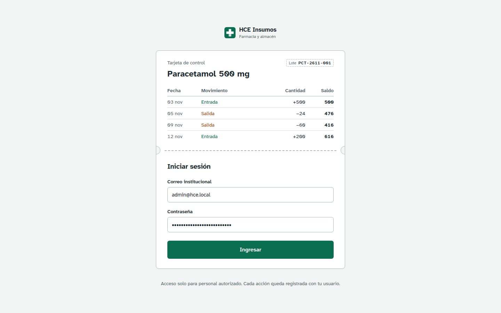 | 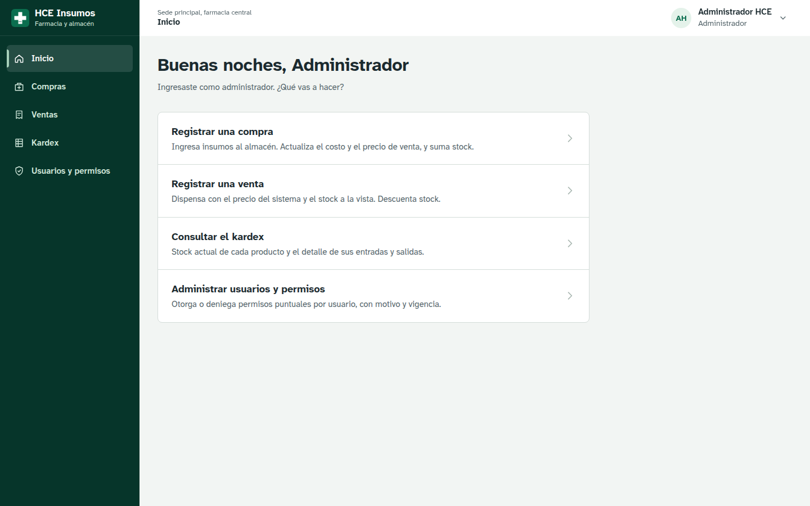 |
| **Compra con varias líneas (precio de venta = costo × 1.35)** | **Registrar producto (modal)** |
| 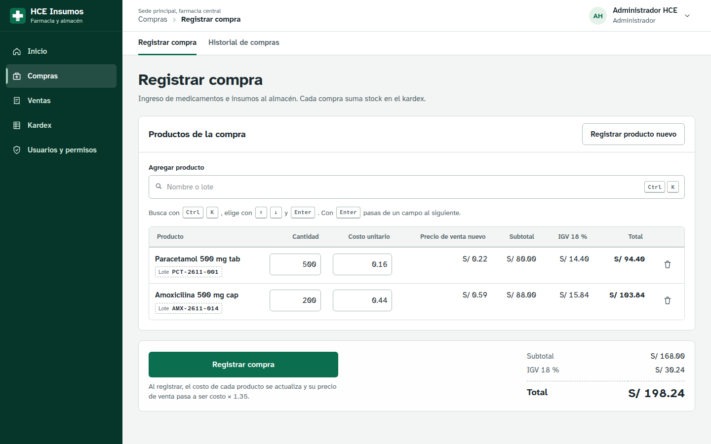 | 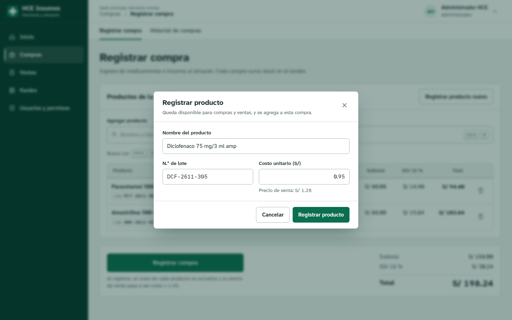 |
| **Venta: cantidad mayor al stock** | **Kardex: stock actual, costo y precio de venta** |
|  | 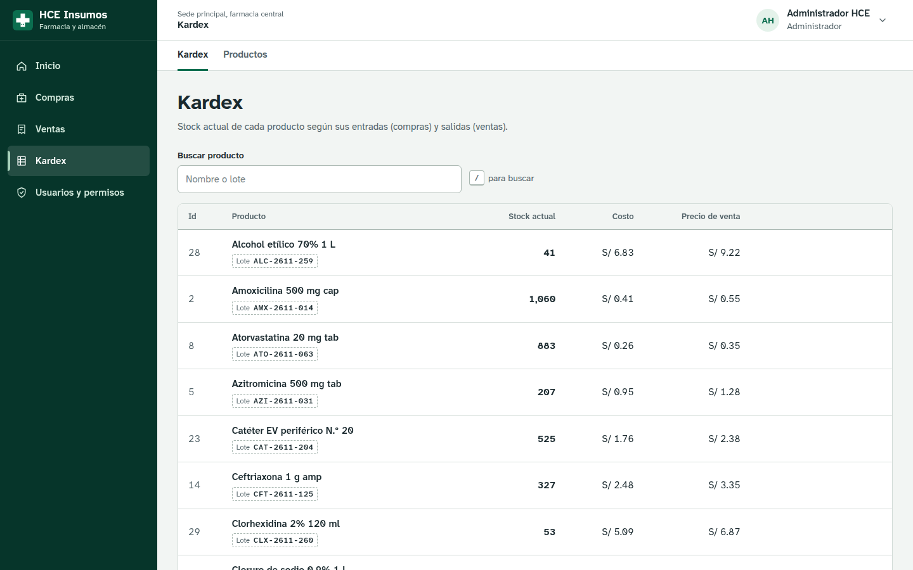 |
| **Kardex: movimientos por producto** | **Seguridad: permisos y excepciones por usuario** |
|  | 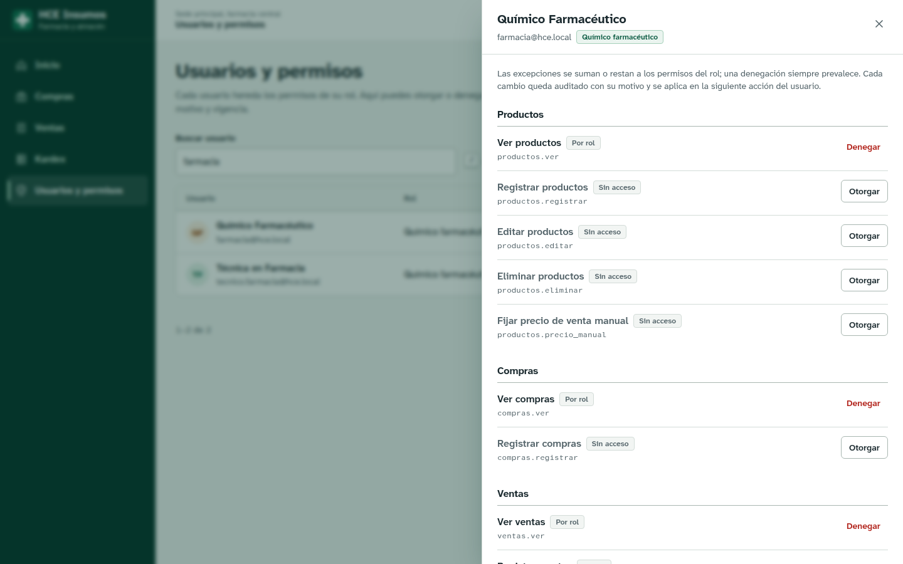 |
| **Productos: alta, edición y eliminación lógica** | **Editar producto** |
| 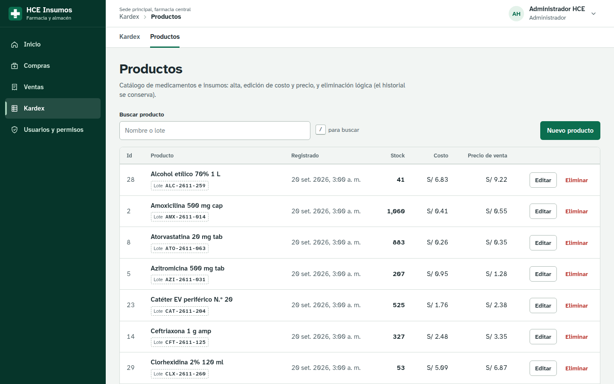 | 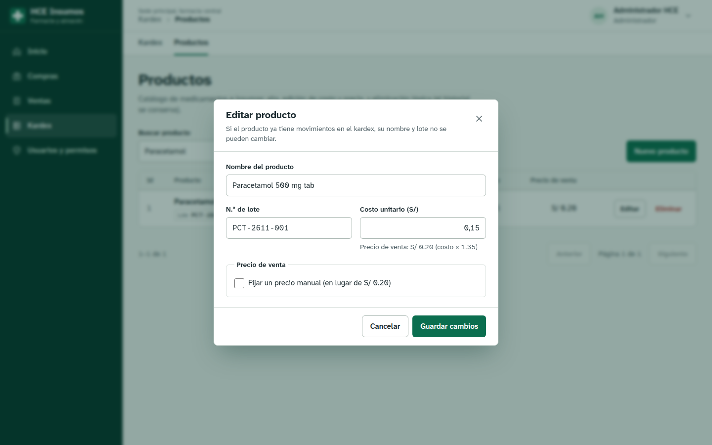 |
| **Menú de usuario** | **Vista tablet (820 px)** |
| 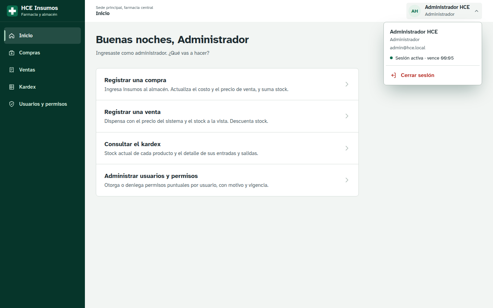 | 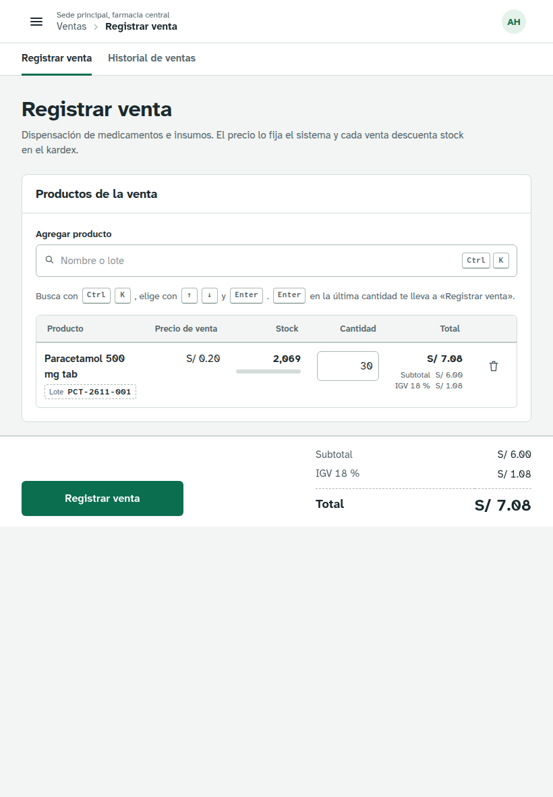 |

---

## 3. Arquitectura

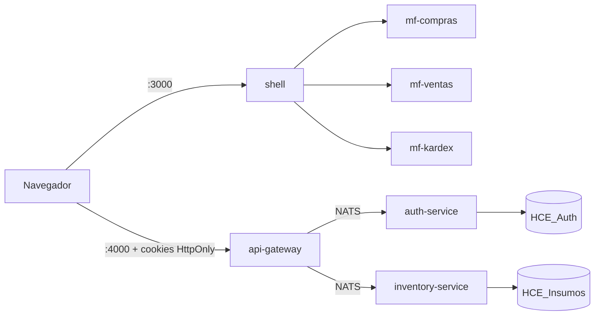

**Backend (microservicios)**

- `api-gateway`: recibe todas las peticiones HTTP. Valida el JWT con la clave pública (sin consultar a
  `auth-service`), revisa permisos y CSRF, y reenvía la petición por NATS mediante `AuthFacade` e
  `InventarioFacade`.
- `auth-service`: login, renovación de tokens, cierre de sesión, usuarios y permisos. Base `HCE_Auth`.
- `inventory-service`: productos, compras, ventas y kardex. Base `HCE_Insumos`.
- Cada servicio se puede escalar por separado (`make scale`) y NATS reparte los mensajes entre las réplicas.
- Los dos microservicios usan arquitectura hexagonal: `domain/` (reglas), `application/` (un caso de uso por
  clase) e `infrastructure/` (SQL Server, NATS). ESLint impide que el dominio importe NestJS o la base de datos.
  Justificación para sistemas de salud en [`docs/ARQUITECTURA.md`](docs/ARQUITECTURA.md#justificación-en-sistemas-de-salud).
- Patrones: Facade (`AuthFacade`, `InventarioFacade`), Decorator (`ObservedUseCase`, `AuthorizedUseCase` y
  `@Auth('permiso')`), Repository, base de datos por servicio, contratos versionados (`inventory.v1.*`),
  Transactional Outbox e idempotencia. Cada decisión tiene su [ADR](docs/adr/README.md).

**Frontend (microfrontends)**

- `shell`: login, inicio, menú y seguridad. Une las demás zonas con *rewrites*.
- `mf-compras` (`/compras`), `mf-ventas` (`/ventas`), `mf-kardex` (`/kardex` y `/kardex/productos`).
- Código compartido en `packages/`: `domain` (cálculos y permisos), `api-client` (Axios e interceptores),
  `ui` (componentes), `features` (piezas comunes de pantalla) y `config`.

Documentos:

| Documento | Contenido |
|---|---|
| [`docs/INSTALACION.md`](docs/INSTALACION.md) | Cómo levantar el proyecto paso a paso (`make dev`, `make prod`) |
| [`docs/ARQUITECTURA.md`](docs/ARQUITECTURA.md) | Vista general, contenedores, flujos, modelo de datos, reglas, seguridad y rendimiento |
| [`docs/API_CONTRACT.md`](docs/API_CONTRACT.md) | Contrato de API front ↔ back |
| [`docs/adr/`](docs/adr/README.md) | Decisiones de arquitectura (ADR) |
| [`docs/SEGURIDAD.md`](docs/SEGURIDAD.md) | Amenazas, controles aplicados y su evidencia (OWASP) |

---

## 4. Tecnologías y herramientas

### Backend

| Herramienta | Versión | Para qué se usa |
|---|---|---|
| Node.js | 24 | Entorno de ejecución de los microservicios |
| TypeScript | 5.9 | Lenguaje de backend y frontend |
| NestJS | 11 | Framework del API Gateway y de los microservicios |
| NATS (cliente `nats`) | 2.29 | Mensajería entre el gateway y los microservicios |
| mssql | 12 | Conexión a SQL Server y llamadas a procedimientos almacenados |
| class-validator, class-transformer | 0.15, 0.5 | Validación de los datos que llegan a la API |
| Joi | 18 | Validación de variables de entorno al arrancar |
| @nestjs/jwt | 11 | Firma y verificación de JWT (ES256) |
| argon2id (`node:crypto`) | Node 24 | Hash de contraseñas |
| Helmet | 8 | Cabeceras de seguridad HTTP |
| @nestjs/throttler | 6 | Límite de peticiones |
| @nestjs/swagger | 11 | Documentación OpenAPI (Swagger) |
| @nestjs/terminus | 11 | Health checks |
| pino, nestjs-pino | 10, 5 | Logs en JSON |
| prom-client | 15 | Métricas para Prometheus |

### Frontend

| Herramienta | Versión | Para qué se usa |
|---|---|---|
| Next.js (Multi-Zones) | 16 | Framework de los microfrontends |
| React | 19 | Componentes de la interfaz |
| Tailwind CSS | 4 | Estilos y diseño responsivo |
| TanStack Query | 5 | Peticiones al API y caché en el navegador |
| Axios | 1.21 | Cliente HTTP con interceptores para JWT y CSRF |
| React Hook Form | 7 | Manejo de formularios |
| Zod | 4 | Validación de formularios |
| pnpm (workspaces) | 11 | Gestor de paquetes y monorepo del frontend y backend |

### Base de datos

| Herramienta | Versión | Para qué se usa |
|---|---|---|
| SQL Server | 2022 | Bases `HCE_Auth` y `HCE_Insumos` |
| T-SQL | - | Tablas, procedimientos almacenados, tipos tabla, vista indexada y triggers |
| sqlcmd (mssql-tools18) | - | Ejecución de los scripts de `database/init` |

### Infraestructura

| Herramienta | Versión | Para qué se usa |
|---|---|---|
| Docker y Docker Compose | 24+ / v2 | Levantar todo el sistema con un comando |
| NATS Server | 2.10 | Servidor de mensajería, con TLS |
| OpenSSL | - | Certificados TLS internos (`scripts/setup.sh`) |
| Prometheus | - | Recolección de métricas (perfil `monitoring`) |
| Grafana | - | Paneles de métricas (perfil `monitoring`) |

### Pruebas y calidad

| Herramienta | Versión | Para qué se usa |
|---|---|---|
| Jest | 30 | Pruebas unitarias del backend |
| Supertest | 7 | Pruebas e2e del API Gateway |
| Vitest, Testing Library | 5, 16 | Pruebas del frontend |
| Playwright | 1.59 | Prueba en navegador real y capturas de pantalla |
| Postman, Newman | 6 | Colección de la API y su ejecución por consola |
| ESLint, Prettier | 9, 3 | Estilo de código y límites entre capas |
| GitHub Actions | - | CI: lint, pruebas, scripts SQL y construcción de imágenes |
| Dependabot, gitleaks, Trivy | - | Actualización de dependencias, búsqueda de secretos y escaneo de imágenes |

---

## 5. Seguridad

Basada en OWASP Top 10 2021 y OWASP API Security Top 10 2023. El detalle está en [`docs/SEGURIDAD.md`](docs/SEGURIDAD.md).

| Tema | Qué se hizo |
|---|---|
| Inicio de sesión | JWT ES256 de 30 min en cookie `HttpOnly`, `SameSite=Strict` y `Secure`. La clave privada solo está en `auth-service` |
| Sesión | El refresh token cambia en cada uso y en la base solo se guarda su hash. Si se reutiliza uno viejo se cierra la sesión. Duración máxima de 12 h |
| Fuerza bruta | 10 intentos de login por minuto por IP y bloqueo de la cuenta tras 5 fallos en 15 min. Siempre la misma respuesta, exista o no el usuario |
| Contraseñas | argon2id |
| CSRF | Token ligado a la sesión en el header `X-CSRF-Token` |
| CORS | Solo se acepta el origen del front |
| Cabeceras | Helmet (CSP, HSTS, `nosniff`, `X-Frame-Options`); CSP con *nonce* en el front |
| Permisos | Cada endpoint exige un permiso; los roles dan permisos base y el administrador puede ajustar los de cada usuario |
| Datos de entrada | Se rechazan campos no esperados y hay límites de tamaño |
| Inyección SQL | Solo procedimientos almacenados con parámetros; la aplicación no puede leer tablas directamente |
| Stock | Al vender se bloquean los productos, así dos ventas simultáneas no dejan el stock en negativo |
| Auditoría | Triggers guardan quién cambió qué, cuándo, y los valores antes y después |
| Red interna | TLS en NATS y SQL Server; ninguno de los dos se publica fuera de Docker |
| Contenedores | Usuario no root, solo lectura y sin privilegios extra |
| Secretos | Los genera `scripts/setup.sh` y no se suben al repositorio |

---

## 6. Rendimiento y escalabilidad

- El stock se lee de una vista indexada (`vw_StockProducto`) que SQL Server mantiene al día, sin sumar todos los
  movimientos en cada consulta.
- Un documento con varias líneas se guarda en una sola llamada a la base (tipos tabla `tt_LineaCompra`,
  `tt_LineaVenta`).
- `READ_COMMITTED_SNAPSHOT`: los listados y el kardex no esperan a las ventas en curso.
- El gateway no guarda sesión y valida el JWT localmente. Con `make scale`, 30 peticiones se repartieron 11/10/9
  entre 3 réplicas.
- Pool de conexiones, reintento ante deadlock, timeouts en cada llamada y paginación obligatoria.
- Concurrencia probada: 15 ventas simultáneas sobre un stock de 7 dieron 7 aceptadas, 8 rechazadas y stock final 0.

---

## 7. Base de datos (SQL Server)

Los scripts de `database/init/` crean las dos bases, las tablas, los procedimientos almacenados, los triggers de
auditoría, los logins de la aplicación y los datos demo. Se ejecutan en orden al levantar el sistema y se pueden
repetir sin error. El detalle de cada archivo está en la [sección 10](#base-de-datos-1).

Ejecutar las consultas de ejemplo: `docker compose exec -T sqlserver bash -c '/opt/mssql-tools18/bin/sqlcmd -S localhost -U sa -P "$MSSQL_SA_PASSWORD" -C -I' < database/queries/consultas_tsql.sql`

---

## 8. Pruebas

| Prueba | Comando | Qué revisa |
|---|---|---|
| Backend, unitarias (67) | `cd backend && pnpm test` | Cálculo de montos e IGV, compras y ventas, stock, idempotencia, login y sesiones, permisos, decoradores |
| Backend, API (13) | `cd backend && pnpm test:e2e` | El gateway real: cabeceras de seguridad, CORS, tokens inválidos, CSRF, permisos, cookies |
| Frontend (84) | `cd frontend && pnpm -r test` | Montos e IGV, permisos y menús, interceptores de Axios, mensajes de error, validación de formularios |
| Navegador (13 pasos) | `make test-browser` | Login, compra, venta con error de stock, kardex, historial, productos (crear, editar, eliminar), seguridad y vista tablet. Falla si hay errores en la consola |
| Postman (33 peticiones, 35 comprobaciones) | `make test-api` | Flujo completo contra el sistema levantado en Docker |
| SQL | CI | Ejecuta los scripts dos veces seguidas y las consultas de ejemplo |

---

## 9. Modo desarrollo

`make dev` levanta el mismo sistema pero con el código montado desde `backend/` y `frontend/`
(`docker-compose.dev.yml`):

- Backend: cada microservicio corre con `nest start --watch` y se reinicia al guardar un archivo.
- Frontend: cada microfrontend corre con `next dev` y la página se actualiza al guardar.
- Las dependencias se instalan en el equipo con `pnpm install` (lo hace `make dev` si faltan).
- La primera compilación tarda 1 a 2 minutos; el avance se ve con `make logs`.

Para volver a las imágenes de producción basta con `make prod`.

## 10. Estructura

| Carpeta | Qué contiene |
|---|---|
| `backend/` | Microservicios: `api-gateway`, `auth-service`, `inventory-service` y librerías compartidas (`libs/`) |
| `frontend/` | Microfrontends: `shell`, `mf-compras`, `mf-ventas`, `mf-kardex` y paquetes compartidos (`packages/`) |
| `database/` | Scripts de SQL Server y consultas de ejemplo |
| `infra/` | Configuración de NATS, SQL Server, Prometheus y Grafana |
| `e2e/` | Prueba en navegador y capturas |
| `postman/` | Colección y entorno para probar la API |
| `scripts/` | `setup.sh`: secretos y certificados |
| `docs/` | Documentación |

### Backend

```text
backend/
├── apps/
│   ├── api-gateway/src/                 Única entrada HTTP
│   │   ├── auth/                        Login, refresh, logout, /me y AuthFacade
│   │   │   └── revocation/              Recibe por NATS los cierres de sesión y cambios de permisos
│   │   ├── admin/                       Endpoints de seguridad (usuarios y permisos)
│   │   ├── inventario/                  Controladores de productos, compras, ventas, kardex e InventarioFacade
│   │   │   └── dto/                     Validación de los datos que llegan
│   │   ├── health/                      GET /health
│   │   ├── security/                    Módulo que registra los guards globales
│   │   ├── common/
│   │   │   ├── decorators/              @Auth, @Public, @Idempotent, @CurrentUser
│   │   │   ├── guards/                  JWT, permisos, CSRF y límite de peticiones
│   │   │   ├── security/                Cookies, token CSRF y usuario autenticado
│   │   │   ├── filters/                 Errores en formato RFC 7807
│   │   │   ├── interceptors/            Idempotency-Key y timeout por petición
│   │   │   ├── middleware/              requestId, Content-Type y limpieza de la entrada
│   │   │   ├── rpc/                     Envío por NATS con timeout
│   │   │   └── dto/                     Paginación
│   │   ├── messaging/                   Conexión a NATS
│   │   ├── metrics/                     Métricas HTTP
│   │   ├── config/                      Variables de entorno
│   │   ├── main.ts                      Arranque
│   │   └── swagger.ts                   Documentación OpenAPI
│   │
│   ├── auth-service/src/                Microservicio de identidad
│   │   ├── domain/
│   │   │   ├── usuario/                 Usuario e interfaz de su repositorio
│   │   │   ├── sesion/                  Refresh token e interfaz del repositorio de sesiones
│   │   │   ├── permisos/                Interfaz del repositorio de permisos y excepciones
│   │   │   ├── security/                Interfaces para hash de contraseñas y emisión de tokens
│   │   │   └── events/                  Interfaz para publicar eventos de sesión
│   │   ├── application/
│   │   │   ├── use-cases/session/       Login, refresh, logout
│   │   │   ├── use-cases/seguridad/     Consultar y cambiar permisos de usuarios
│   │   │   └── session/                 Emisión de la pareja de tokens
│   │   ├── infrastructure/
│   │   │   ├── persistence/             Repositorios SQL Server
│   │   │   ├── security/                JWT ES256 y argon2id
│   │   │   ├── messaging/               Controladores NATS y publicador de eventos
│   │   │   ├── logging/                 Registro de eventos de seguridad
│   │   │   ├── bootstrap/               Creación de usuarios demo
│   │   │   └── config/                  Variables de entorno
│   │   └── auth.module.ts               Une las capas
│   │
│   └── inventory-service/src/           Microservicio de inventario
│       ├── domain/
│       │   ├── producto/                Producto e interfaz de su repositorio
│       │   ├── compra/                  Agregado Compra e interfaz de su repositorio
│       │   ├── venta/                   Agregado Venta (valida el stock) e interfaz de su repositorio
│       │   ├── kardex/                  Interfaz de lectura del kardex
│       │   └── shared/                  Money, Cantidad, política de precios e IGV, eventos
│       ├── application/use-cases/
│       │   ├── productos/               Registrar, actualizar, eliminar, listar
│       │   ├── compras/                 Registrar, listar, obtener
│       │   ├── ventas/                  Registrar, listar, obtener
│       │   └── kardex/                  Listar kardex y movimientos
│       ├── infrastructure/
│       │   ├── persistence/mssql/       Repositorios que llaman a los procedimientos almacenados
│       │   ├── messaging/nats/          Controladores NATS
│       │   ├── messaging/outbox/        Publicación de eventos CompraRegistrada / VentaRegistrada
│       │   └── config/                  Variables de entorno
│       └── inventory.module.ts          Une las capas
│
└── libs/                                Código compartido por los tres servicios
    ├── core/src/
    │   ├── application/                 UseCase, decoradores ObservedUseCase y AuthorizedUseCase
    │   ├── domain/                      Base de agregados y eventos de dominio
    │   └── errors/                      AppError
    ├── contracts/src/                   Nombres de mensajes NATS, DTOs, códigos de error, permisos
    └── common/src/
        ├── mssql/                       Ejecución de procedimientos y reintento ante deadlock
        ├── nats/                        Conexión a NATS con TLS
        ├── composition/                 provideUseCase: apila los decoradores en cada caso de uso
        ├── logging/  metrics/           Logs JSON y métricas
        ├── rpc/                         Conversión de errores al responder por NATS
        ├── process/                     Cierre ordenado ante errores no controlados
        └── config/                      Variables de entorno comunes
```

### Frontend

```text
frontend/
├── apps/
│   ├── shell/src/                       :3000
│   │   ├── app/(auth)/login/            Página de login
│   │   ├── app/(app)/                   Inicio y layout con menú
│   │   ├── app/(app)/seguridad/         Gestión de permisos por usuario
│   │   ├── features/auth/               Formulario de login y tarjetas de inicio
│   │   ├── features/seguridad/          Lista de usuarios, panel de permisos y excepciones
│   │   └── proxy.ts                     CSP con nonce y redirección al login sin sesión
│   ├── mf-compras/src/                  :3001, ruta /compras
│   │   ├── app/  app/historial/         Registrar compra e historial
│   │   └── features/compras/            Formulario, líneas, modal de producto nuevo, validación
│   ├── mf-ventas/src/                   :3002, ruta /ventas
│   │   ├── app/  app/historial/         Registrar venta e historial
│   │   └── features/ventas/             Formulario, líneas con stock, validación
│   └── mf-kardex/src/                   :3003, ruta /kardex
│       ├── app/  app/productos/         Kardex y catálogo de productos
│       ├── features/kardex/             Tabla de kardex y modal de movimientos
│       └── features/productos/          Lista, alta, edición y eliminación de productos
│
└── packages/                            Código compartido por las cuatro apps
    ├── domain/src/                      Montos, IGV, precio de venta, permisos por rol, rutas seguras
    ├── api-client/src/
    │   ├── http-client.ts               Axios con interceptores (JWT, CSRF, refresh)
    │   ├── endpoints/                   Una función por endpoint del API
    │   └── react/                       Hooks de TanStack Query y sesión
    ├── ui/src/                          Componentes con Tailwind
    │   ├── primitives/                  Botón, campo, spinner
    │   ├── data/                        Tabla, paginación, montos, gráfico
    │   ├── domain/                      Líneas de documento, totales, buscador de productos, stock
    │   ├── overlay/                     Modal, panel lateral, confirmación, avisos
    │   ├── layout/                      Estructura de la app, menú de usuario
    │   └── styles/                      Tema de colores
    ├── features/src/
    │   ├── shell/                       Layout de cada zona y control de permisos por página
    │   ├── productos/                   Selector de productos
    │   ├── documentos/                  Historial de compras y ventas
    │   ├── hooks/                       Cálculo de totales por línea
    │   ├── errors/                      Aviso de errores de la API
    │   └── providers/                   TanStack Query, sesión y avisos
    └── config/src/                      CSP y protección de rutas
```

### Base de datos

```text
database/
├── init/                         Se ejecutan en orden al levantar el sistema
│   ├── 00_databases.sql          Crea HCE_Insumos y HCE_Auth
│   ├── 01_insumos_schema.sql     Tablas, índices y vista de stock
│   ├── 02_insumos_audit.sql      Triggers de auditoría e inmutabilidad
│   ├── 03_insumos_procedures.sql Procedimientos de productos, compras, ventas y kardex
│   ├── 04_auth_schema.sql        Usuarios, sesiones e historial de login
│   ├── 04b_auth_permisos.sql     Roles, permisos y excepciones por usuario
│   ├── 05_security.sql           Logins de la aplicación (solo EXECUTE)
│   └── 06_seed.sql               Datos demo
├── queries/consultas_tsql.sql    Consultas de ejemplo
└── scripts/init-db.sh            Ejecuta los scripts de init/ dentro del contenedor db-init
```

### Otras carpetas

```text
infra/
├── nats/nats.conf                TLS y permisos por servicio
├── mssql/mssql.conf              TLS obligatorio
└── monitoring/
    ├── prometheus.yml            Qué servicios se miden
    ├── alerts.yml                Alertas
    └── grafana/provisioning/     Fuente de datos y panel "HCE overview"
e2e/
├── smoke.mjs                     Prueba en navegador (13 pasos)
└── screenshots.mjs               Genera docs/screenshots
postman/                          Colección, entorno local y README
scripts/setup.sh                  Genera .env, claves JWT y certificados TLS
docs/
├── adr/                          Decisiones de arquitectura
├── INSTALACION.md                Cómo levantar el proyecto
└── screenshots/                  Capturas usadas en el README
docker-compose.yml                Todos los servicios (modo producción)
docker-compose.dev.yml            Modo desarrollo: código montado y recarga al guardar
docker-compose.db-access.yml      Publica SQL Server en 127.0.0.1:1433 para DBeaver
Makefile                          Comandos: make dev, make prod, make ps, make logs…
```

La tabla "Dónde buscar" con la ubicación de las piezas principales (reglas de venta, Facade, Decorator,
interceptores) está en [`docs/ARQUITECTURA.md` §4](docs/ARQUITECTURA.md#4-estructura-del-repositorio).
