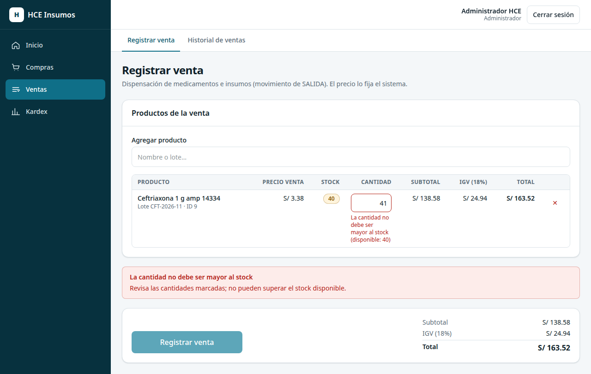
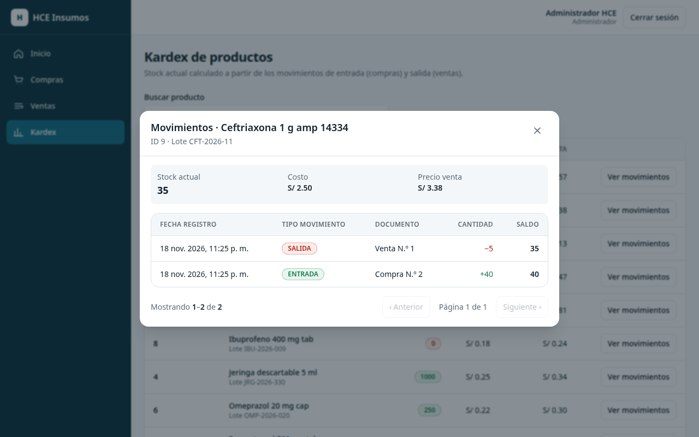
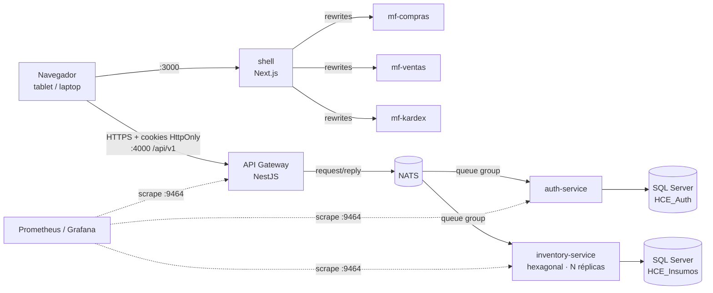

# HCE Insumos — Control de medicamentos e insumos médicos

Solución del **Examen Técnico — Especialista Desarrollo HCE**: plataforma de compras, ventas
(dispensación) y **kardex** de medicamentos/insumos, construida con **microservicios NestJS**,
**microfrontends Next.js**, **SQL Server** y desplegada con **Docker Compose**.

| Capa | Tecnología | Detalle |
|---|---|---|
| Frontend | Next.js 16 · React 19 · Tailwind CSS 4 · TanStack Query | **Multi-Zones** (shell + `mf-compras` + `mf-ventas` + `mf-kardex`), Axios con **interceptores** JWT/CSRF |
| API Gateway | NestJS 11 (HTTP) | Enrutamiento y seguridad centralizada: JWT, RBAC, CORS, Helmet, rate limit, CSRF, Swagger, RFC 7807 |
| Microservicios | NestJS 11 sobre **NATS** | `auth-service` (identidad) y `inventory-service` (**arquitectura hexagonal**) con queue groups → escalado horizontal |
| Base de datos | SQL Server 2022 | Una BD por servicio, **procedimientos almacenados** con TVP, **vista indexada** de stock, **triggers de auditoría** |
| Observabilidad | pino (JSON) · Prometheus · Grafana | Request-ID extremo a extremo, métricas RED, health checks |

---

## 1. Levantar todo con Docker

**Requisitos:** Docker 24+ con Compose v2, `openssl`, ~4 GB de RAM libres (SQL Server usa 2 GB).

```bash
git clone <url-del-repo> hce-insumos && cd hce-insumos
./scripts/setup.sh              # genera .env: contraseñas aleatorias + par de claves ES256 del JWT
docker compose up -d --build    # BD + init + NATS + 3 servicios + 4 microfronts (primera vez: ~5 min)
docker compose ps               # todos deben quedar "healthy"
```

| Recurso | URL |
|---|---|
| Aplicación web | http://localhost:3000 |
| API Gateway | http://localhost:4000/api/v1 |
| Swagger (OpenAPI) | http://localhost:4000/api/docs |
| Health | http://localhost:4000/api/v1/health |
| SQL Server (solo localhost) | `localhost,1433` — usuario `sa`, contraseña en `.env` |

**Usuarios demo** (contraseña `Hce.Demo.2026!`, configurable en `.env` → `SEED_USERS_PASSWORD`):

| Usuario | Rol | Puede |
|---|---|---|
| `admin@hce.local` | ADMIN | Todo |
| `almacen@hce.local` | ALMACENERO | Productos, compras, consultas |
| `farmacia@hce.local` | FARMACEUTICO | Ventas, consultas |

Comandos útiles (`make help`):

```bash
make logs          # logs de todos los servicios
make scale         # inventory-service x3 (balanceo automático por NATS queue group)
make monitoring    # Prometheus http://localhost:9090 · Grafana http://localhost:3100 (admin / GRAFANA_ADMIN_PASSWORD)
make test          # lint + typecheck + tests de backend y frontend
make db-shell      # sqlcmd como sa
make clean         # baja todo y BORRA los volúmenes
```

---

## 2. Funcionalidades (enunciado 1.1.1 y 1.2)

| Servicio | Endpoint | Vista |
|---|---|---|
| Registrar Producto | `POST /productos` | Modal **Registrar producto** dentro de Compras |
| Actualizar Producto | `PUT /productos/:id` (concurrencia optimista `rowVersion`) | — (API/Swagger) |
| Listar Producto | `GET /productos?search&page&pageSize` (incluye stock) | Buscador de productos |
| Registrar Compra | `POST /compras` + `Idempotency-Key` | `/compras` — varias líneas, crea productos inexistentes |
| Listar Compra | `GET /compras?desde&hasta&page` · `GET /compras/:id` | `/compras/historial` |
| Registrar Venta | `POST /ventas` + `Idempotency-Key` | `/ventas` — precio venta y stock por línea, validación de stock |
| Listar Venta | `GET /ventas?desde&hasta&page` · `GET /ventas/:id` | `/ventas/historial` |
| Listar Kardex | `GET /kardex` · `GET /kardex/:id/movimientos` | `/kardex` — botón **Ver movimientos** por fila (modal) |

Reglas de negocio implementadas (detalle en [`docs/ARQUITECTURA.md` §8](docs/ARQUITECTURA.md#8-reglas-de-negocio-e-interpretaciones)):

- **Compra** → `CompraCab` + `CompraDet`, actualiza `Productos.Costo` y `Productos.PrecioVenta = costo × 1.35`,
  y genera `MovimientoCab/Det` **tipo 1 (Entrada)** con `Id_DocumentoOrigen = Id_CompraCab`. Todo en **una transacción**.
- **Venta** → precio de venta tomado del servidor, stock calculado desde la **tabla movimiento**; si la cantidad
  supera el stock: *"La cantidad no debe ser mayor al stock"*. `Subtotal = cantidad × precio`,
  `IGV = 18 % del subtotal`, `Total = Subtotal + IGV`. Genera movimiento **tipo 2 (Salida)**.
  > El PDF escribe `IGV = cantidad × precio × 1.18`; eso es el total con impuesto, no el impuesto. Se implementa
  > `IGV = subtotal × 0.18` para que `Total = Subtotal + IGV` sea correcto (tasa configurable: `IGV_RATE`).
- **Kardex** → `Id_producto, nombre_producto, stock_actual, costo, precio venta`; el modal muestra
  `Fecha registro, tipo movimiento, cantidad` (+ documento origen y saldo acumulado).

### Capturas

| Compra (varias líneas, IGV y precio venta calculados) | Venta: cantidad mayor al stock |
|---|---|
|  |  |
| **Modal Registrar producto** | **Kardex: movimientos por producto** |
|  |  |

---

## 3. Arquitectura



- **API Gateway** (`backend/apps/api-gateway`): única puerta HTTP. Verifica el JWT **localmente** con la clave
  pública ES256 (sin llamada a `auth-service` por request), aplica RBAC, CSRF, rate limit y traduce errores a
  RFC 7807. Habla con los servicios a través de **Facades** (`AuthFacade`, `InventarioFacade`).
- **inventory-service** (`backend/apps/inventory-service`): **Hexagonal / Clean**
  `domain/` (agregados `Compra`, `Venta`, entidad `Producto`, VO `Money`, servicio `PoliticaPrecios`, puertos) →
  `application/` (casos de uso + decorador `ObservedUseCase`) → `infrastructure/` (adaptadores SQL Server y NATS).
  Los límites entre capas **se verifican con ESLint** (`no-restricted-imports`).
  Justificación para sistemas de salud: [`docs/ARQUITECTURA.md`](docs/ARQUITECTURA.md#justificación-de-arquitectura-hexagonal-en-sistemas-de-salud).
- **Patrones**: Facade (gateway), Decorator (GoF `ObservedUseCase` + decoradores compuestos `@Auth`, `@Idempotent`,
  `@ApiProblemResponses` con `applyDecorators`), Repository/Ports & Adapters, CQRS-lite (read models de kardex),
  Idempotency Key, Composition Root. **SOLID** explicado en [`docs/EVALUACION_TEORICA.md` §7](docs/EVALUACION_TEORICA.md#7-principios-solid).

Documentos:

| Documento | Contenido |
|---|---|
| [`docs/EVALUACION_TEORICA.md`](docs/EVALUACION_TEORICA.md) | Evaluación teórica: API REST, monolito vs microservicios, BFF, DDD, hexagonal, Facade/Decorator, SOLID y **diagrama con Docker, monitoreo e integraciones** |
| [`docs/ARQUITECTURA.md`](docs/ARQUITECTURA.md) | C4, secuencias, modelo ER, seguridad OWASP, rendimiento, observabilidad |
| [`docs/API_CONTRACT.md`](docs/API_CONTRACT.md) | Contrato de API front ↔ back |
| [`docs/GUION_VIDEO.md`](docs/GUION_VIDEO.md) | Guion del video de evidencia |
| [`docs/ENTREGA.md`](docs/ENTREGA.md) | Checklist requisito → ubicación y plantilla de correo |

---

## 4. Seguridad (OWASP Top 10 2021 / API Security Top 10 2023)

| Control | Implementación |
|---|---|
| Autenticación | JWT **ES256** de **30 min** en cookie `HttpOnly; SameSite=Strict; Secure`(prod). Clave privada solo en `auth-service`. `alg`, `iss`, `aud` fijados |
| Sesión | Refresh token opaco (SHA-256 en BD), **rotación** en cada uso y **detección de reuso** (revoca la familia) |
| Fuerza bruta | Rate limit de login por IP + **bloqueo de cuenta** atómico (5 intentos / 15 min) + respuesta uniforme y hash dummy (anti-enumeración) |
| Contraseñas | scrypt asíncrono con salt aleatorio, `timingSafeEqual` |
| CSRF | *Signed double-submit cookie* (`X-CSRF-Token`) + SameSite=Strict |
| CORS | Solo el origen del front (`CORS_ORIGINS`), sin comodines (validado al arrancar) |
| Cabeceras | Helmet: CSP, HSTS, `X-Content-Type-Options: nosniff`, `X-Frame-Options: DENY`, `Referrer-Policy`, `Permissions-Policy`; CSP con *nonce* en el front |
| Autorización | Deny-by-default (guard global), RBAC por rol, el **precio de venta lo decide el servidor** |
| Entrada | `ValidationPipe` whitelist + `forbidNonWhitelisted` (sin mass assignment), límites de tamaño (body 100 kb, 100 líneas, paginación ≤ 100) |
| Inyección SQL | Solo **procedimientos almacenados con parámetros tipados**; el login de la app tiene **solo `EXECUTE`** (no puede leer tablas) |
| Integridad | Transacciones `XACT_ABORT`, `UPDLOCK/HOLDLOCK` (sin sobreventa), FKs (incluida la polimórfica del movimiento), CHECKs de importes, documentos y kardex **inmutables** |
| Auditoría | Triggers → `audit.Auditoria` (antes/después en JSON, usuario de negocio, request-id), append-only |
| Secretos | Generados por `scripts/setup.sh`, nunca versionados; NATS con usuario y permisos por servicio |
| Contenedores | Usuario no root, `read_only`, `cap_drop: ALL`, `no-new-privileges`, redes segmentadas (`backend` interna) |
| Supply chain | Versiones fijadas, lockfiles, `pnpm audit`, Dependabot, gitleaks y Trivy en CI |

---

## 5. Rendimiento y escalabilidad

- **Stock O(1)**: vista indexada `vw_StockProducto` mantenida por el motor (consistente con la tabla movimiento).
- **Un round-trip por documento**: TVP (`tt_LineaCompra`, `tt_LineaVenta`) + SP transaccional.
- **READ_COMMITTED_SNAPSHOT**: lecturas (kardex, listados) no bloquean escrituras.
- **Gateway stateless** y verificación JWT local; **NATS queue groups** reparten carga entre réplicas
  (`make scale` → verificado: 30 requests repartidas 11/10/9 entre 3 réplicas).
- Pool de conexiones por servicio, reintento con backoff ante deadlock (1205), timeouts en todo RPC (sin
  peticiones colgadas), paginación obligatoria, scrypt fuera del event loop, `OPTION (RECOMPILE)` en búsquedas.
- Concurrencia verificada: 15 ventas simultáneas sobre stock 7 → **7 aceptadas, 8 rechazadas, stock final 0**.

---

## 6. Base de datos (SQL Server)

```
database/
├── init/                       # ejecutados en orden por el contenedor db-init (idempotentes)
│   ├── 00_databases.sql        # HCE_Insumos + HCE_Auth, RCSI
│   ├── 01_insumos_schema.sql   # tablas del enunciado, FKs, CHECKs, índices, vista indexada, TVPs
│   ├── 02_insumos_audit.sql    # generador de triggers de auditoría + triggers de inmutabilidad
│   ├── 03_insumos_procedures.sql # SP: insertar/listar/actualizar/eliminar producto, compras, ventas, kardex
│   ├── 04_auth_schema.sql      # usuarios, sesiones, historial de login + SP
│   ├── 05_security.sql         # logins de aplicación con mínimo privilegio (solo EXECUTE)
│   └── 06_seed.sql             # datos demo (vía los mismos SP)
├── queries/consultas_tsql.sql  # consultas T-SQL: CRUD, kardex, valorización, reportes, auditoría, integridad
└── scripts/init-db.sh
```

Ejecutar las consultas de ejemplo: `docker compose exec -T sqlserver bash -c '/opt/mssql-tools18/bin/sqlcmd -S localhost -U sa -P "$MSSQL_SA_PASSWORD" -C -I' < database/queries/consultas_tsql.sql`

---

## 7. Pruebas

| Suite | Comando | Cobertura |
|---|---|---|
| Backend unit (37) | `cd backend && pnpm test` | `Money`, `PoliticaPrecios`, agregados `Compra`/`Venta`, casos de uso (reintento por precio, stock bajo lock), decorador, `MssqlExecutor` (deadlock/errores), auth (bloqueo, anti-enumeración, reuso de refresh), CSRF, RBAC, transporte RPC |
| Backend e2e (9) | `cd backend && pnpm test:e2e` | Gateway real: Helmet/nosniff/CSP, CORS, 401, `alg:none` y firma falsa, CSRF, RBAC, validación estricta, `Idempotency-Key`, cookies HttpOnly |
| Frontend (27) | `cd frontend && pnpm -r test` | Dinero/IGV/precio, interceptores Axios (refresh single-flight, CSRF), schemas zod |
| API (28 requests / 35 aserciones) | `npx newman run postman/hce-insumos.postman_collection.json -e postman/hce-insumos.local.postman_environment.json` | Flujo completo contra el stack Docker |
| SQL | CI ejecuta `database/init` dos veces (idempotencia) y `consultas_tsql.sql` | |

---

## 8. Desarrollo local sin Docker (opcional)

```bash
docker compose up -d sqlserver db-init nats          # infraestructura
cd backend  && pnpm install && pnpm start:auth        # + start:inventory, start:gateway (variables: ver docker-compose.yml)
cd frontend && pnpm install && pnpm dev               # shell :3000 + zonas :3001-3003
```

## 9. Estructura

```
├── backend/     NestJS monorepo: apps/{api-gateway,auth-service,inventory-service}, libs/{contracts,common}
├── frontend/    pnpm workspace: apps/{shell,mf-compras,mf-ventas,mf-kardex}, packages/{domain,api-client,ui,config}
├── database/    scripts SQL Server (init, consultas)
├── infra/       nats.conf, Prometheus, Grafana
├── postman/     colección + entorno
├── docs/        evaluación teórica, arquitectura, contrato, guion de video, checklist de entrega
├── scripts/     setup.sh (secretos)
└── docker-compose.yml · Makefile · .github/workflows/ci.yml
```
