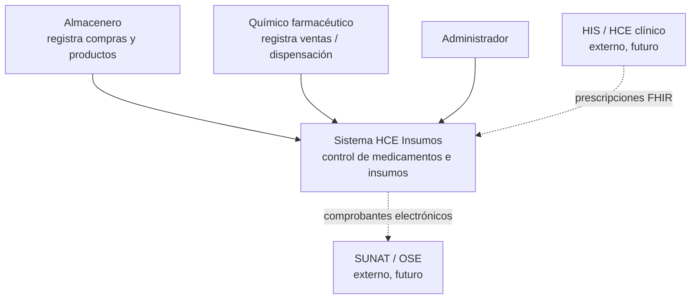
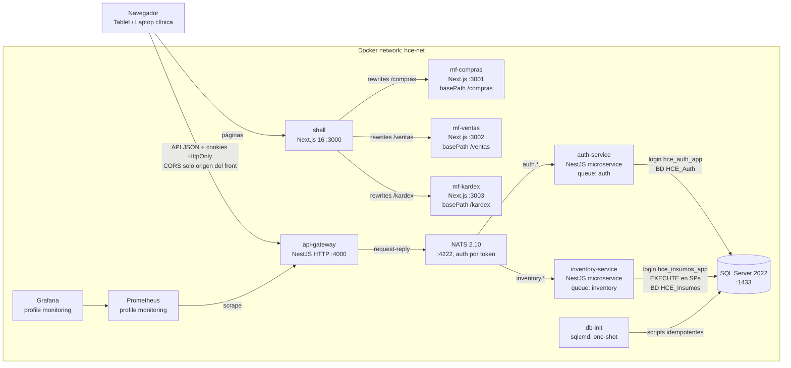
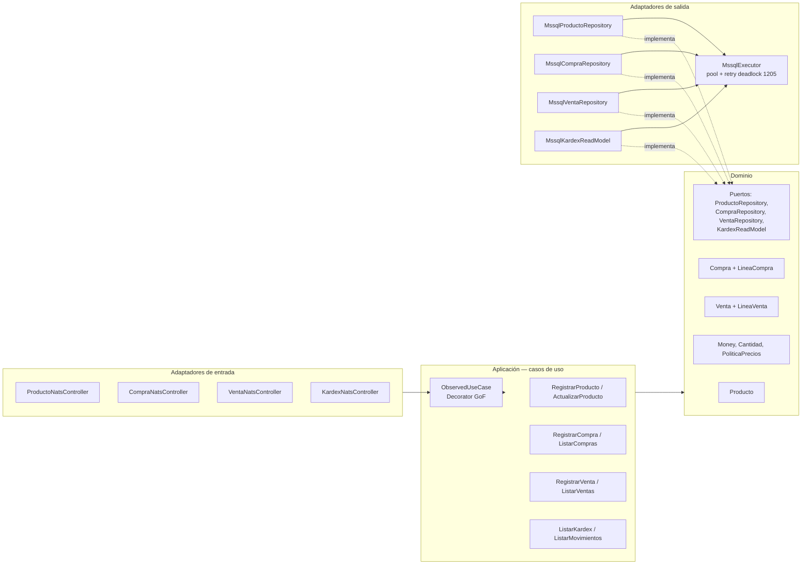
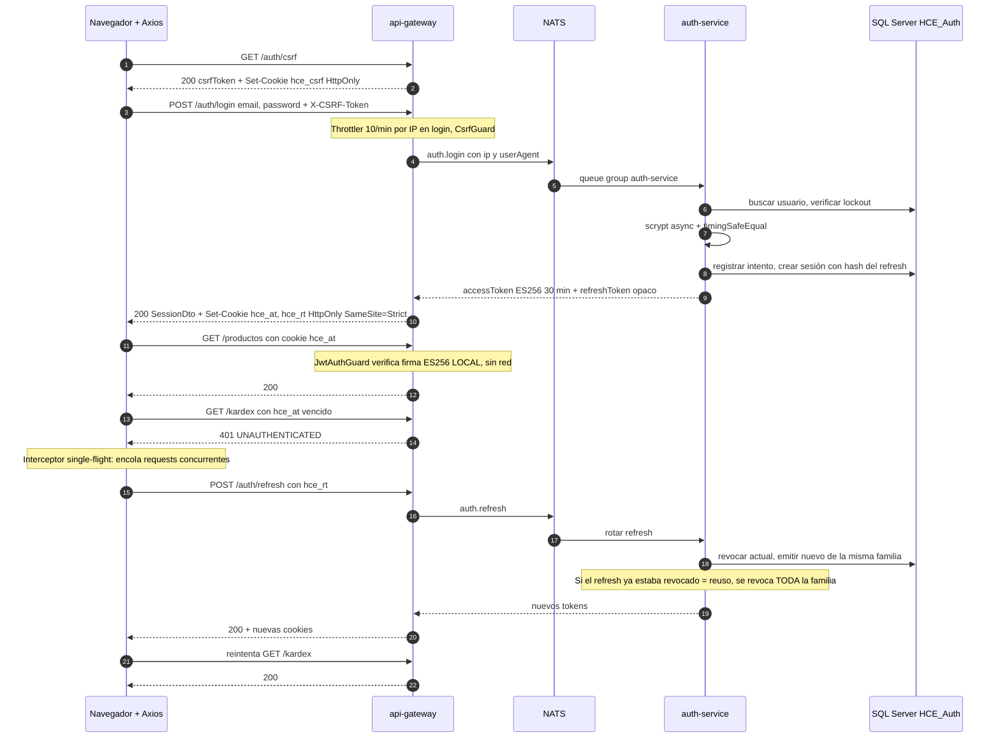
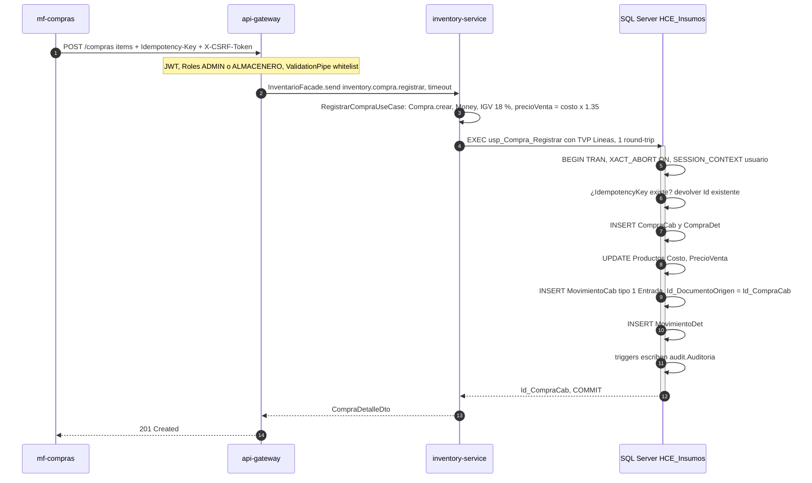
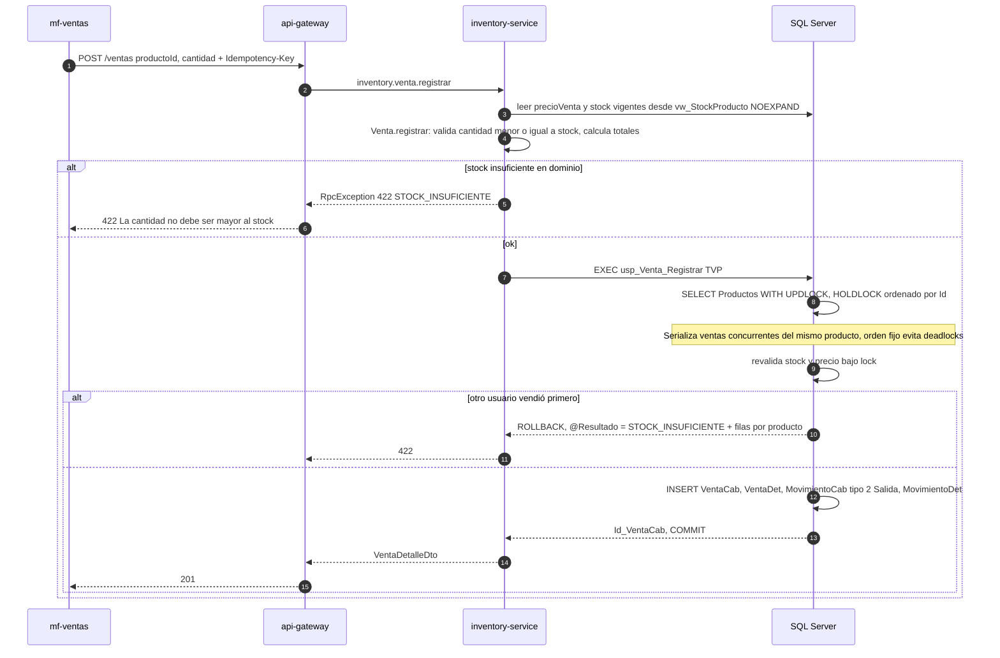
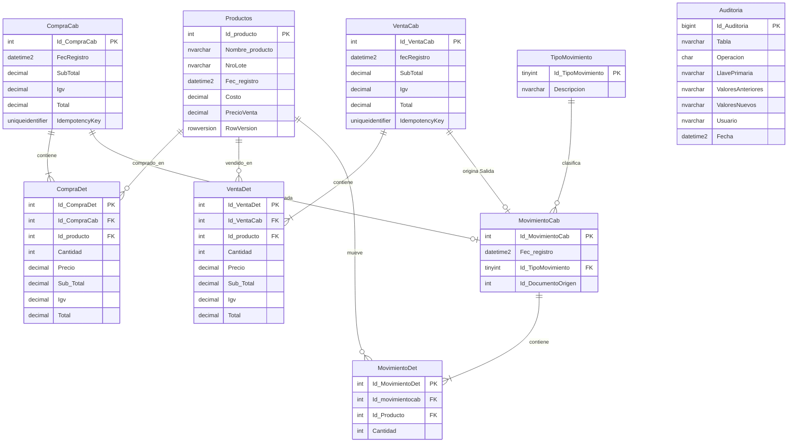

# Arquitectura implementada — HCE Insumos

Documento técnico de la solución entregada. Complementa a [EVALUACION_TEORICA.md](./EVALUACION_TEORICA.md)
(conceptos) y a [API_CONTRACT.md](./API_CONTRACT.md) (contrato HTTP).

## Índice

1. [Contexto (C4 nivel 1)](#1-contexto-c4-nivel-1)
2. [Contenedores (C4 nivel 2)](#2-contenedores-c4-nivel-2)
3. [Estructura del repositorio](#3-estructura-del-repositorio)
4. [Arquitectura hexagonal del inventory-service](#4-arquitectura-hexagonal-del-inventory-service)
5. [Justificación de Arquitectura Hexagonal en sistemas de salud](#justificación-de-arquitectura-hexagonal-en-sistemas-de-salud)
6. [Flujos (diagramas de secuencia)](#6-flujos-diagramas-de-secuencia)
7. [Modelo de datos](#7-modelo-de-datos)
8. [Reglas de negocio e interpretaciones](#8-reglas-de-negocio-e-interpretaciones)
9. [Seguridad (OWASP)](#9-seguridad-owasp)
10. [Rendimiento y escalabilidad](#10-rendimiento-y-escalabilidad)
11. [Patrones de diseño aplicados](#11-patrones-de-diseño-aplicados)
12. [Observabilidad](#12-observabilidad)

---

## 1. Contexto (C4 nivel 1)



## 2. Contenedores (C4 nivel 2)



| Contenedor | Tecnología | Responsabilidad | Escala |
|---|---|---|---|
| `shell` | Next.js 16 (App Router, standalone) | Login, layout común, navegación, composición de zonas | Horizontal (stateless) |
| `mf-compras` / `mf-ventas` / `mf-kardex` | Next.js 16 Multi-Zones | Un microfront por capacidad de negocio, build y deploy independientes | Horizontal |
| `api-gateway` | NestJS 11 + Express | Única puerta HTTP: seguridad, enrutamiento, composición, Swagger | Horizontal (stateless, JWT local) |
| `nats` | NATS 2.10 | Bus request-reply; **queue groups** balancean entre réplicas | Cluster |
| `auth-service` | NestJS 11 microservice | Usuarios, credenciales, sesiones, emisión de JWT ES256 | `--scale auth-service=N` |
| `inventory-service` | NestJS 11 microservice, hexagonal | Productos, compras, ventas, kardex | `--scale inventory-service=N` |
| `sqlserver` | SQL Server 2022 | Persistencia, invariantes atómicas, auditoría | Vertical / AG de lectura |
| `db-init` | mssql-tools (sqlcmd) | Crea BDs, esquema, SPs, triggers, logins, seed | One-shot |

## 3. Estructura del repositorio

```text
hce-insumos-platform/
├── backend/                         # Monorepo NestJS (nest-cli monorepo mode)
│   ├── apps/
│   │   ├── api-gateway/src/
│   │   │   ├── auth/                # AuthController + AuthFacade + cookies/CSRF
│   │   │   ├── inventario/          # Controllers productos/compras/ventas/kardex + InventarioFacade
│   │   │   ├── common/              # guards (Jwt, Roles, Csrf), decorators, filters (RFC 7807), interceptors
│   │   │   ├── health/ metrics/
│   │   │   └── main.ts
│   │   ├── auth-service/src/
│   │   │   ├── domain/ application/ infrastructure/
│   │   │   └── main.ts
│   │   └── inventory-service/src/
│   │       ├── domain/              # Agregados, VOs, puertos — sin NestJS ni mssql
│   │       ├── application/         # Casos de uso + decorador ObservedUseCase
│   │       ├── infrastructure/      # persistence/mssql (adaptadores), messaging/nats (controllers)
│   │       └── main.ts
│   └── libs/
│       ├── contracts/               # Patrones de mensaje NATS + DTOs compartidos
│       └── common/                  # AppError, MssqlExecutor (pool + reintentos), NATS, logger, métricas
├── frontend/                        # pnpm workspace
│   ├── apps/{shell,mf-compras,mf-ventas,mf-kardex}
│   └── packages/{domain,ui,api-client,config}  # Reglas puras, Tailwind UI, Axios + interceptores, config Next
├── database/
│   ├── init/                        # 00..N_*.sql ejecutados por db-init en orden
│   └── queries/consultas_tsql.sql   # Consultas T-SQL solicitadas / reportes
├── infra/nats/nats.conf             # Usuarios NATS con permisos mínimos por servicio
├── infra/monitoring/                # prometheus.yml, provisioning Grafana
├── scripts/setup.sh                 # Genera .env (secretos + claves ES256)
├── postman/                         # Colección + environment
├── docs/                            # Este documento y la evaluación teórica
└── docker-compose.yml
```

## 4. Arquitectura hexagonal del inventory-service



Reglas:

- `domain/` es TypeScript puro: **cero imports** de `@nestjs/*`, `mssql` o `nats`.
- `application/` depende solo de `domain/` (puertos por símbolos de inyección).
- `infrastructure/` implementa puertos y conoce los detalles (SPs, TVPs, NATS).
- El cableado (qué adaptador implementa qué puerto) vive en el módulo Nest — único lugar con conocimiento de ambos lados.

## Justificación de Arquitectura Hexagonal en sistemas de salud

| Necesidad del sector salud | Cómo la resuelve la arquitectura hexagonal |
|---|---|
| **Trazabilidad regulatoria** (DIGEMID, Ley 29733 de protección de datos personales, NTS de HCE del MINSA) | Las reglas (stock, precios, IGV, inmutabilidad de documentos) están **en un único lugar** (dominio) y son auditables por lectura de código; la persistencia agrega auditoría por triggers sin mezclarla con la lógica |
| **Interoperabilidad cambiante** (HL7 FHIR, SIS/SITEDS, SUNAT, HIS legado) | Cada integración es un **adaptador** nuevo detrás de un puerto. Integrar FHIR `MedicationDispense` = un adaptador de entrada que invoca `RegistrarVentaUseCase`; el dominio no cambia |
| **Seguridad del paciente** — un error de stock o lote es un riesgo clínico | Dominio testeable en aislamiento con repositorios en memoria: pruebas rápidas y exhaustivas de las invariantes críticas |
| **Auditabilidad** | Casos de uso explícitos (un caso de uso = una intención de negocio registrable); el decorador `ObservedUseCase` registra cada ejecución con `requestId` y usuario sin contaminar la lógica |
| **Longevidad** — los sistemas clínicos viven 10–20 años | El framework (NestJS), la BD (SQL Server) o el transporte (NATS) pueden reemplazarse sin reescribir las reglas de negocio |
| **Alta disponibilidad** | Los adaptadores pueden cambiar por versiones resilientes (cache, colas) sin impacto funcional |
| **Validación y certificación** | Un núcleo pequeño y estable reduce el alcance de re-validación ante cambios de infraestructura |

## 6. Flujos (diagramas de secuencia)

### 6.1 Login, uso y refresh



### 6.2 Registrar compra (Entrada)



### 6.3 Registrar venta (Salida) con control de concurrencia de stock



## 7. Modelo de datos

Base `HCE_Insumos` (esquema `dbo` para el modelo solicitado, `audit` para la bitácora). Se respetan
exactamente los nombres de tablas y columnas del enunciado; se agregan solo columnas técnicas
(`RowVersion`, `IdempotencyKey`, `Id_Usuario`).



Objetos de soporte:

| Objeto | Propósito |
|---|---|
| `dbo.vw_StockProducto` (`WITH SCHEMABINDING` + índice cluster único) | **Vista indexada**: stock = Σ entradas − Σ salidas por producto, materializada y mantenida por el motor en cada INSERT. Lectura O(1) con `WITH (NOEXPAND)` — el stock se basa en la tabla de movimientos, como pide el enunciado, sin recalcular |
| `UQ_MovimientoCab_Tipo_Documento` (único `Id_TipoMovimiento, Id_DocumentoOrigen`) | Un documento genera exactamente un movimiento; habilita la búsqueda del origen |
| Tipos tabla (`dbo.tt_LineaCompra`, `dbo.tt_LineaVenta`) | TVP: todas las líneas del documento viajan en **una** llamada |
| CHECK constraints | `Cantidad > 0`, `Precio >= 0`, `Total = Sub_Total + Igv`, `Id_TipoMovimiento IN (1,2)` |
| Índices únicos filtrados `IdempotencyKey IS NOT NULL` | Idempotencia de `POST /compras` y `POST /ventas` |
| `UQ_Productos_Nombre_Lote` | Un producto/lote no se duplica |
| Triggers `trg_*_Auditoria` (generados por `audit.usp_GenerarTriggerAuditoria`) y `trg_*_Inmutable` | INSERT/UPDATE/DELETE → `audit.Auditoria` con JSON (`FOR JSON`) de valores anteriores/nuevos y usuario de `SESSION_CONTEXT(N'user_id')` |
| Base `HCE_Auth` (esquema `auth`) | `Usuarios`, `Sesiones` (hash SHA-256 del refresh, familia, revocación), `HistorialLogin` |

Stored procedures (CRUD solicitados + operaciones de negocio): `usp_Producto_Insertar`, `usp_Producto_Listar`,
`usp_Producto_ObtenerPorId`, `usp_Producto_ObtenerPorIds`, `usp_Producto_Actualizar`, `usp_Producto_Eliminar`, `usp_Compra_Registrar`,
`usp_Compra_Listar`, `usp_Compra_Obtener`, `usp_Venta_Registrar`, `usp_Venta_Listar`, `usp_Venta_Obtener`,
`usp_Kardex_Listar`, `usp_Kardex_Movimientos`.

## 8. Reglas de negocio e interpretaciones

| # | Regla | Interpretación / decisión |
|---|---|---|
| R1 | IGV de venta/compra | El PDF indica `Igv = cantidad × PrecioVenta × 1.18`; aplicado literalmente, `Total = Subtotal + Igv` sería **2.18 × Subtotal** (doble conteo). Se implementa la norma tributaria peruana: **`Igv = Subtotal × 0.18`**, `Total = Subtotal + Igv` (tasa configurable `IGV_RATE`). Equivale a que `Total = cantidad × PrecioVenta × 1.18`, que es la intención evidente de la fórmula |
| R2 | Precio de venta | Al registrar una compra: `Productos.Costo = costo unitario de la compra` (último costo) y `PrecioVenta = round(Costo × 1.35, 2)` (margen configurable `MARGEN_VENTA`) |
| R3 | Stock | `stock = Σ MovimientoDet.Cantidad (tipo 1) − Σ (tipo 2)` vía vista indexada. Nunca se almacena en `Productos` |
| R4 | Validación de stock | Doble: (1) en el front al digitar y en el dominio para feedback inmediato, (2) **bajo lock** en el SP para concurrencia. Mensaje: *"La cantidad no debe ser mayor al stock"* |
| R5 | Precio de venta en la venta | Lo decide el servidor (precio vigente), el cliente solo envía `productoId` y `cantidad` |
| R6 | Documentos financieros inmutables | Compras y ventas **no se eliminan ni editan** (integridad contable y kardex). Una corrección sería una nota de crédito/devolución (fuera de alcance). Solo se eliminan **productos sin movimientos** |
| R7 | Productos duplicados en un documento | Se rechazan (cada `productoId` aparece una vez por documento) |
| R8 | Montos | `DECIMAL(18,2)`; aritmética en céntimos enteros en el dominio (VO `Money`) para evitar errores de punto flotante |
| R9 | Fechas | `DATETIME2` en UTC (`SYSUTCDATETIME()`); el front las muestra en `America/Lima` |

## 9. Seguridad (OWASP)

### 9.1 OWASP Top 10 (2021)

| Riesgo | Controles implementados |
|---|---|
| **A01** Broken Access Control | `JwtAuthGuard` global + `@Public()` explícito; `RolesGuard` con `@Roles()`; CORS con lista blanca del origen del front y `credentials: true`; `userId` siempre del token |
| **A02** Cryptographic Failures | JWT **ES256** (clave privada solo en auth-service; gateway solo tiene la pública → no puede emitir tokens); refresh tokens opacos de 256 bits guardados como **SHA-256**; contraseñas con **scrypt** (sal 16 B) y `timingSafeEqual`; cookies `Secure` en producción |
| **A03** Injection | 100 % consultas parametrizadas / SPs con parámetros tipados y TVPs; sin SQL dinámico concatenado; validación estricta con `class-validator`; React escapa la salida |
| **A04** Insecure Design | Invariantes en el dominio + revalidación atómica en BD; idempotencia; documentos inmutables; modelado de amenazas por flujo (secciones 6.x) |
| **A05** Security Misconfiguration | Helmet (CSP, HSTS, frameguard, `X-Content-Type-Options: nosniff`, `Referrer-Policy`), `x-powered-by` deshabilitado, Swagger off en producción, contenedores non-root, puertos internos no publicados (NATS, servicios) |
| **A06** Vulnerable Components | Lockfiles congelados, `pnpm audit` en CI, imágenes base mínimas (alpine), versiones fijadas |
| **A07** Identification & Auth Failures | Access token de **30 min**; refresh con **rotación y detección de reuso** (revoca la familia); bloqueo tras 5 intentos fallidos (15 min, 423); rate limit 5/min en login; mensajes genéricos (no enumeración de usuarios); logout revoca sesión |
| **A08** Software & Data Integrity | Algoritmo JWT fijado (`algorithms: ['ES256']`, `iss`, `aud` verificados); `rowversion` para concurrencia optimista; build reproducible |
| **A09** Logging & Monitoring Failures | Logs JSON (pino) con `requestId` propagado gateway → NATS → servicio; redacción de `cookie`, `authorization`, `password`; auditoría de datos por triggers; historial de login; métricas Prometheus |
| **A10** SSRF | Sin fetch de URLs de usuario; servicios internos solo accesibles en la red Docker |

### 9.2 Controles adicionales

- **CSRF**: cookies `SameSite=Strict` + **double-submit** (`hce_csrf` HttpOnly ↔ header `X-CSRF-Token`) verificado en todo método no seguro.
- **XSS**: el token nunca es accesible a JS (HttpOnly) — mitigación exigida por el enunciado; CSP en el gateway y el front.
- **Mínimo privilegio en BD**: `hce_insumos_app` solo tiene `EXECUTE` sobre los SPs (sin `SELECT/UPDATE/DELETE` directo a tablas); `audit.Auditoria` es append-only; `sa` solo lo usa `db-init`.
- **NATS** con autenticación por token: un contenedor ajeno no puede publicar en `inventory.*`.
- **Secretos** fuera del repositorio (`.env` generado por `scripts/setup.sh`, `.env.example` sin valores reales).
- **Límites**: body ≤ 100 KB, `pageSize ≤ 100`, ≤ 100 líneas por documento, timeouts RPC.

## 10. Rendimiento y escalabilidad

| Posible cuello de botella | Mitigación |
|---|---|
| Calcular stock sumando todos los movimientos | **Vista indexada** materializada: lectura constante con `NOEXPAND`, mantenida por el motor |
| Lectores bloqueados por escritores (listados durante ventas) | **READ_COMMITTED_SNAPSHOT ON**: lecturas por versionado de filas, sin bloqueos compartidos |
| N round-trips por línea de documento | **TVP**: cabecera + N líneas + movimiento en **una** llamada y **una** transacción |
| Apertura de conexiones | Pool `mssql` por servicio con tamaño configurable (`DB_POOL_MAX`) y reutilización |
| Deadlocks bajo carga | Locks en orden determinista (por `Id_producto`) + **reintento automático** con backoff ante error 1205 |
| Gateway con estado / sesión | **Stateless**: JWT verificado localmente (sin round-trip a auth-service por request) |
| Un solo proceso de dominio | **NATS queue groups**: N réplicas de `inventory-service` reciben mensajes balanceados sin configuración extra |
| Hash de contraseñas bloqueando el event loop | `scrypt` **asíncrono** (libuv threadpool), nunca `scryptSync` |
| Respuestas gigantes | Paginación obligatoria `OFFSET/FETCH` con `pageSize ≤ 100` e índices de soporte (`FecRegistro DESC`, `MovimientoDet(Id_Producto) INCLUDE(Cantidad)`) |
| Servicio lento arrastrando al gateway | `timeout()` RxJS por llamada RPC → 504 controlado; health checks Terminus |
| Re-fetch redundante en el front | TanStack Query (cache, dedupe, `staleTime`); búsqueda con debounce; `next build` standalone |
| Escalado futuro | Rate limit con storage Redis compartido al tener múltiples gateways; réplicas de lectura de SQL Server (AG) para kardex/reportes |

## 11. Patrones de diseño aplicados

| Patrón | Dónde | Propósito |
|---|---|---|
| **Facade** | `apps/api-gateway/src/inventario/inventario.facade.ts`, `apps/api-gateway/src/auth/auth.facade.ts` | Ocultar NATS, patrones de mensaje, timeouts y mapeo de errores RPC → HTTP detrás de métodos de negocio |
| **Decorator (GoF)** | `apps/inventory-service/src/application/decorators/observed-use-case.decorator.ts` | Agregar logging y métricas a cualquier caso de uso sin modificarlo |
| **Decorator (TS/Nest)** | `apps/api-gateway/src/common/decorators/` (`@Roles`, `@Public`, `@CurrentUser`, `@Idempotent`, `@ApiProblemResponses`) | Metadatos declarativos y composición con `applyDecorators` |
| **Ports & Adapters** | `inventory-service` | Independencia de infraestructura |
| **Repository** | `domain/*/*.repository.port.ts` + `infrastructure/persistence/mssql/*` | Abstracción de persistencia |
| **Aggregate / Value Object** | `Compra`, `Venta`, `Money`, `Cantidad` | Invariantes de negocio |
| **API Gateway** | `api-gateway` | Punto único de entrada, seguridad transversal |
| **Interceptor / Chain of Responsibility** | Axios interceptors (front), Nest interceptors/guards (back) | Preocupaciones transversales en cadena |
| **Single-flight** | `frontend/packages/api-client` | Un único refresh para N requests 401 concurrentes |

## 12. Observabilidad

- **Logs**: JSON estructurado (pino) en stdout de cada contenedor; `requestId` (header `X-Request-Id` o generado)
  viaja en el payload NATS y aparece en los logs de gateway y servicios.
- **Métricas**: `prom-client` en el gateway (latencia por ruta, códigos HTTP, métricas de proceso Node) — Prometheus
  las recolecta; Grafana las grafica (`docker compose --profile monitoring up -d`).
- **Salud**: `GET /api/v1/health` (Terminus) verifica NATS y la respuesta de cada microservicio; los contenedores
  tienen `healthcheck` en compose para orden de arranque.
- **Auditoría de datos**: `audit.Auditoria` (quién, qué, cuándo, antes/después) — consultas de ejemplo en
  `database/queries/consultas_tsql.sql`.
