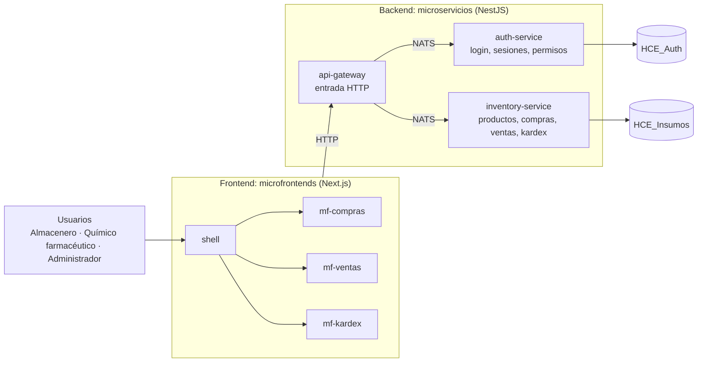
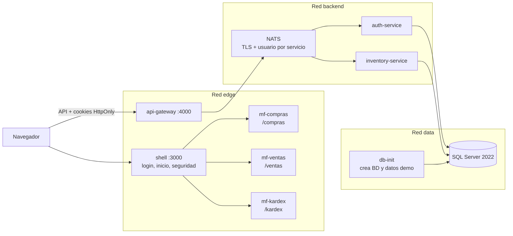
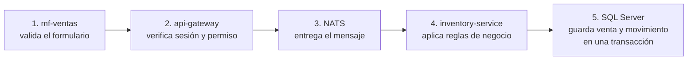
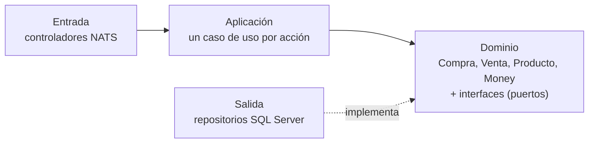
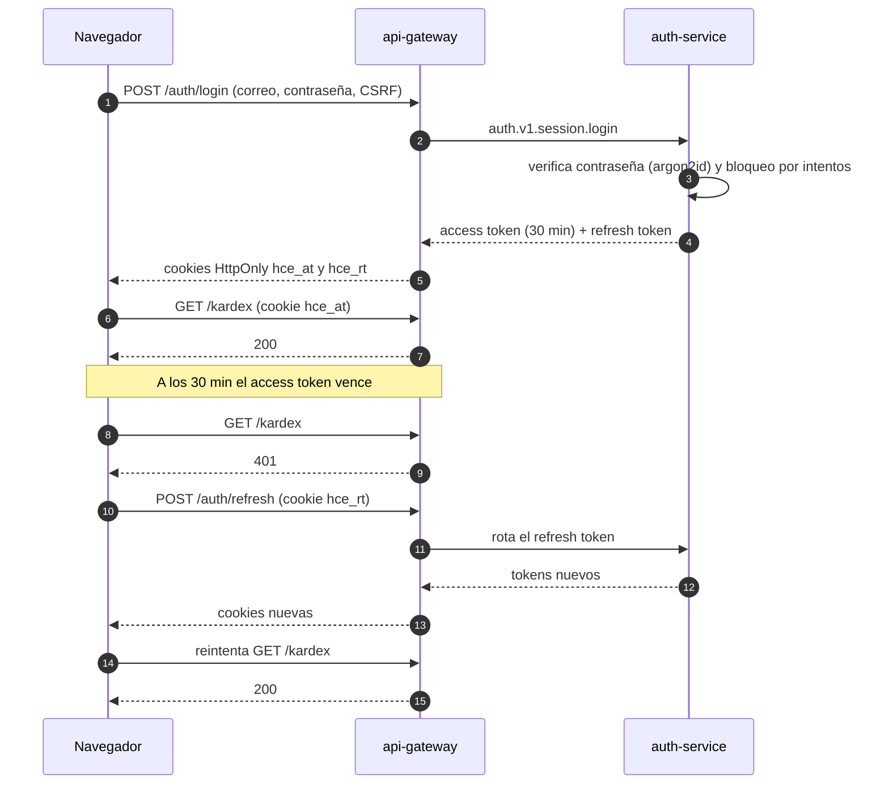
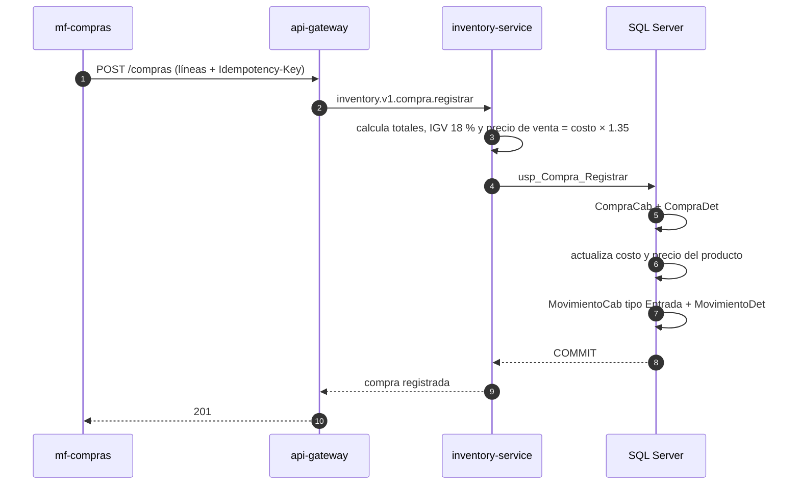
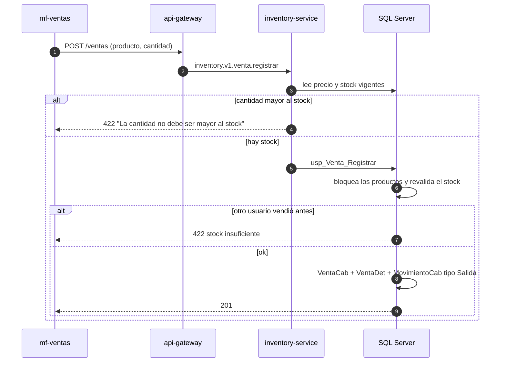
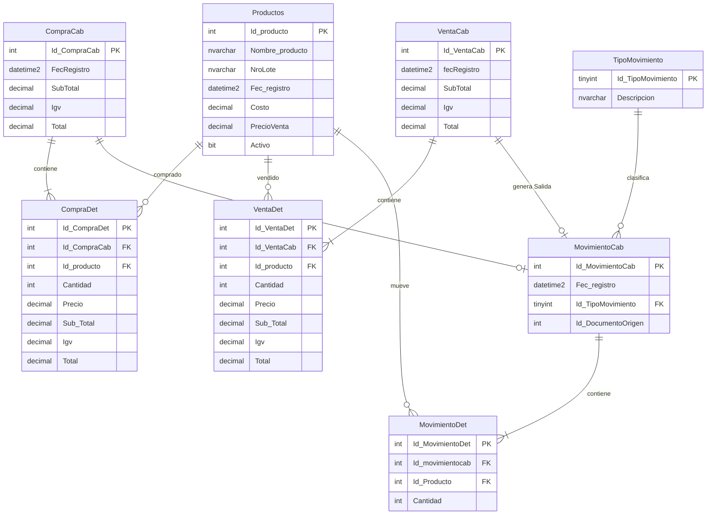
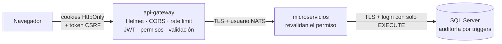

# Arquitectura: HCE Insumos

Sistema para controlar la compra, venta y stock de medicamentos e insumos clínicos, construido con
**microservicios** en el backend (NestJS + NATS) y **microfrontends** en el frontend (Next.js Multi-Zones).
El contrato HTTP está en [API_CONTRACT.md](./API_CONTRACT.md). Para levantarlo, ver [INSTALACION.md](./INSTALACION.md).

## Índice

1. [Vista general: microservicios y microfrontends](#1-vista-general-microservicios-y-microfrontends)
2. [Contenedores](#2-contenedores)
3. [Recorrido de una petición](#3-recorrido-de-una-petición)
4. [Estructura del repositorio](#4-estructura-del-repositorio)
5. [Arquitectura hexagonal](#5-arquitectura-hexagonal)
6. [Flujos principales](#6-flujos-principales)
7. [Modelo de datos](#7-modelo-de-datos)
8. [Reglas de negocio](#8-reglas-de-negocio)
9. [Seguridad](#9-seguridad)
10. [Rendimiento](#10-rendimiento)
11. [Patrones de diseño](#11-patrones-de-diseño)
12. [Observabilidad](#12-observabilidad)
13. [Tecnologías y herramientas](#13-tecnologías-y-herramientas)

---

## 1. Vista general: microservicios y microfrontends



| Parte | Estilo | Piezas | Qué las hace independientes |
|---|---|---|---|
| Backend | Microservicios | `api-gateway`, `auth-service`, `inventory-service` | Cada uno es una app NestJS con su propio contenedor; se comunican solo por mensajes NATS; cada servicio de negocio tiene su propia base de datos; se escalan por separado |
| Frontend | Microfrontends | `shell`, `mf-compras`, `mf-ventas`, `mf-kardex` | Cada uno es una app Next.js con su propio contenedor y build; el `shell` los une bajo un mismo dominio con *rewrites* |

| Quién | Qué hace en el sistema |
|---|---|
| Almacenero | Registra productos y compras (entradas de stock) |
| Químico farmacéutico | Registra ventas o dispensaciones (salidas de stock) |
| Administrador | Todo lo anterior, más la gestión de usuarios y permisos |

Las tres ideas principales:

- **Un solo punto de entrada.** El navegador solo habla con el `api-gateway`; los demás microservicios no están expuestos.
- **Cada microservicio con su base de datos.** `auth-service` usa `HCE_Auth` e `inventory-service` usa `HCE_Insumos`.
- **El stock sale del kardex.** No se guarda en una columna: se calcula con los movimientos de entrada y salida.

## 2. Contenedores



| Contenedor | Tecnología | Función |
|---|---|---|
| `shell` | Next.js 16 | Login, menú, inicio y seguridad. Une los microfronts bajo un mismo dominio |
| `mf-compras` | Next.js 16 | Registrar y listar compras |
| `mf-ventas` | Next.js 16 | Registrar y listar ventas |
| `mf-kardex` | Next.js 16 | Kardex por producto y gestión del catálogo de productos |
| `api-gateway` | NestJS 11 | Única puerta HTTP: autenticación, permisos, validación, Swagger |
| `nats` | NATS 2.10 | Mensajería entre el gateway y los microservicios |
| `auth-service` | NestJS 11 | Usuarios, contraseñas, sesiones, tokens JWT y permisos |
| `inventory-service` | NestJS 11 | Productos, compras, ventas y kardex |
| `sqlserver` | SQL Server 2022 | Bases `HCE_Auth` y `HCE_Insumos` |
| `db-init` | sqlcmd | Ejecuta los scripts de `database/init` una sola vez al arrancar |
| `certs-init` | OpenSSL | Genera los certificados TLS internos |
| `prometheus` / `grafana` | Perfil `monitoring` | Métricas y paneles (opcional) |

Solo se publican en el equipo local los puertos 3000 (front) y 4000 (API). NATS, los microservicios y la base de
datos solo son accesibles dentro de las redes de Docker.

## 3. Recorrido de una petición

Ejemplo: el químico farmacéutico registra una venta.



1. El formulario valida cantidades y avisa si superan el stock.
2. El gateway comprueba el token (cookie HttpOnly), el token CSRF y el permiso `ventas.registrar`.
3. El gateway envía el mensaje `inventory.v1.venta.registrar` por NATS.
4. `inventory-service` arma la venta, calcula subtotal, IGV y total, y vuelve a validar el stock.
5. El procedimiento `usp_Venta_Registrar` bloquea los productos, revalida el stock y guarda en una sola
   transacción la cabecera, el detalle y el movimiento de salida del kardex.

## 4. Estructura del repositorio

El repositorio tiene una carpeta por parte del sistema:

| Carpeta | Qué contiene |
|---|---|
| `backend/` | Los tres microservicios NestJS y las librerías que comparten |
| `frontend/` | Los cuatro microfrontends Next.js y los paquetes que comparten |
| `database/` | Scripts de SQL Server: creación, procedimientos, triggers, datos demo y consultas |
| `infra/` | Configuración de NATS, SQL Server, Prometheus y Grafana |
| `e2e/` | Prueba en navegador real y generador de capturas |
| `postman/` | Colección para probar la API |
| `scripts/` | `setup.sh`: genera secretos y certificados |
| `docs/` | Documentación, decisiones de arquitectura (`adr/`) y capturas |

### Backend

```text
backend/
├── apps/
│   ├── api-gateway/src/                 Única entrada HTTP
│   │   ├── auth/                        Login, refresh, logout, /me y AuthFacade
│   │   │   └── revocation/              Recibe por NATS los cierres de sesión y cambios de permisos
│   │   ├── admin/                       Endpoints de seguridad (usuarios y permisos)
│   │   ├── inventario/                  Controladores de productos, compras, ventas, kardex e InventarioFacade
│   │   │   └── dto/                     Validación de los datos que llegan
│   │   ├── health/                      GET /health
│   │   ├── security/                    Módulo que registra los guards globales
│   │   ├── common/
│   │   │   ├── decorators/              @Auth, @Public, @Idempotent, @CurrentUser
│   │   │   ├── guards/                  JWT, permisos, CSRF y límite de peticiones
│   │   │   ├── security/                Cookies, token CSRF y usuario autenticado
│   │   │   ├── filters/                 Errores en formato RFC 7807
│   │   │   ├── interceptors/            Idempotency-Key y timeout por petición
│   │   │   ├── middleware/              requestId, Content-Type y limpieza de la entrada
│   │   │   ├── rpc/                     Envío por NATS con timeout
│   │   │   └── dto/                     Paginación
│   │   ├── messaging/                   Conexión a NATS
│   │   ├── metrics/                     Métricas HTTP
│   │   ├── config/                      Variables de entorno
│   │   ├── main.ts                      Arranque
│   │   └── swagger.ts                   Documentación OpenAPI
│   │
│   ├── auth-service/src/                Microservicio de identidad
│   │   ├── domain/
│   │   │   ├── usuario/                 Usuario e interfaz de su repositorio
│   │   │   ├── sesion/                  Refresh token e interfaz del repositorio de sesiones
│   │   │   ├── permisos/                Interfaz del repositorio de permisos y excepciones
│   │   │   ├── security/                Interfaces para hash de contraseñas y emisión de tokens
│   │   │   └── events/                  Interfaz para publicar eventos de sesión
│   │   ├── application/
│   │   │   ├── use-cases/session/       Login, refresh, logout
│   │   │   ├── use-cases/seguridad/     Consultar y cambiar permisos de usuarios
│   │   │   └── session/                 Emisión de la pareja de tokens
│   │   ├── infrastructure/
│   │   │   ├── persistence/             Repositorios SQL Server
│   │   │   ├── security/                JWT ES256 y argon2id
│   │   │   ├── messaging/               Controladores NATS y publicador de eventos
│   │   │   ├── logging/                 Registro de eventos de seguridad
│   │   │   ├── bootstrap/               Creación de usuarios demo
│   │   │   └── config/                  Variables de entorno
│   │   └── auth.module.ts               Une las capas
│   │
│   └── inventory-service/src/           Microservicio de inventario
│       ├── domain/
│       │   ├── producto/                Producto e interfaz de su repositorio
│       │   ├── compra/                  Agregado Compra e interfaz de su repositorio
│       │   ├── venta/                   Agregado Venta (valida el stock) e interfaz de su repositorio
│       │   ├── kardex/                  Interfaz de lectura del kardex
│       │   └── shared/                  Money, Cantidad, política de precios e IGV, eventos
│       ├── application/use-cases/
│       │   ├── productos/               Registrar, actualizar, eliminar, listar
│       │   ├── compras/                 Registrar, listar, obtener
│       │   ├── ventas/                  Registrar, listar, obtener
│       │   └── kardex/                  Listar kardex y movimientos
│       ├── infrastructure/
│       │   ├── persistence/mssql/       Repositorios que llaman a los procedimientos almacenados
│       │   ├── messaging/nats/          Controladores NATS
│       │   ├── messaging/outbox/        Publicación de eventos CompraRegistrada / VentaRegistrada
│       │   └── config/                  Variables de entorno
│       └── inventory.module.ts          Une las capas
│
└── libs/                                Código compartido por los tres servicios
    ├── core/src/
    │   ├── application/                 UseCase, decoradores ObservedUseCase y AuthorizedUseCase
    │   ├── domain/                      Base de agregados y eventos de dominio
    │   └── errors/                      AppError
    ├── contracts/src/                   Nombres de mensajes NATS, DTOs, códigos de error, permisos
    └── common/src/
        ├── mssql/                       Ejecución de procedimientos y reintento ante deadlock
        ├── nats/                        Conexión a NATS con TLS
        ├── composition/                 provideUseCase: apila los decoradores en cada caso de uso
        ├── logging/  metrics/           Logs JSON y métricas
        ├── rpc/                         Conversión de errores al responder por NATS
        ├── process/                     Cierre ordenado ante errores no controlados
        └── config/                      Variables de entorno comunes
```

### Frontend

```text
frontend/
├── apps/
│   ├── shell/src/                       :3000
│   │   ├── app/(auth)/login/            Página de login
│   │   ├── app/(app)/                   Inicio y layout con menú
│   │   ├── app/(app)/seguridad/         Gestión de permisos por usuario
│   │   ├── features/auth/               Formulario de login y tarjetas de inicio
│   │   ├── features/seguridad/          Lista de usuarios, panel de permisos y excepciones
│   │   └── proxy.ts                     CSP con nonce y redirección al login sin sesión
│   ├── mf-compras/src/                  :3001, ruta /compras
│   │   ├── app/  app/historial/         Registrar compra e historial
│   │   └── features/compras/            Formulario, líneas, modal de producto nuevo, validación
│   ├── mf-ventas/src/                   :3002, ruta /ventas
│   │   ├── app/  app/historial/         Registrar venta e historial
│   │   └── features/ventas/             Formulario, líneas con stock, validación
│   └── mf-kardex/src/                   :3003, ruta /kardex
│       ├── app/  app/productos/         Kardex y catálogo de productos
│       ├── features/kardex/             Tabla de kardex y modal de movimientos
│       └── features/productos/          Lista, alta, edición y eliminación de productos
│
└── packages/                            Código compartido por las cuatro apps
    ├── domain/src/                      Montos, IGV, precio de venta, permisos por rol, rutas seguras
    ├── api-client/src/
    │   ├── http-client.ts               Axios con interceptores (JWT, CSRF, refresh)
    │   ├── endpoints/                   Una función por endpoint del API
    │   └── react/                       Hooks de TanStack Query y sesión
    ├── ui/src/                          Componentes con Tailwind
    │   ├── primitives/                  Botón, campo, spinner
    │   ├── data/                        Tabla, paginación, montos, gráfico
    │   ├── domain/                      Líneas de documento, totales, buscador de productos, stock
    │   ├── overlay/                     Modal, panel lateral, confirmación, avisos
    │   ├── layout/                      Estructura de la app, menú de usuario
    │   └── styles/                      Tema de colores
    ├── features/src/
    │   ├── shell/                       Layout de cada zona y control de permisos por página
    │   ├── productos/                   Selector de productos
    │   ├── documentos/                  Historial de compras y ventas
    │   ├── hooks/                       Cálculo de totales por línea
    │   ├── errors/                      Aviso de errores de la API
    │   └── providers/                   TanStack Query, sesión y avisos
    └── config/src/                      CSP y protección de rutas
```

### Base de datos

```text
database/
├── init/                         Se ejecutan en orden al levantar el sistema
│   ├── 00_databases.sql          Crea HCE_Insumos y HCE_Auth
│   ├── 01_insumos_schema.sql     Tablas, índices y vista de stock
│   ├── 02_insumos_audit.sql      Triggers de auditoría e inmutabilidad
│   ├── 03_insumos_procedures.sql Procedimientos de productos, compras, ventas y kardex
│   ├── 04_auth_schema.sql        Usuarios, sesiones e historial de login
│   ├── 04b_auth_permisos.sql     Roles, permisos y excepciones por usuario
│   ├── 05_security.sql           Logins de la aplicación (solo EXECUTE)
│   └── 06_seed.sql               Datos demo
├── queries/consultas_tsql.sql    Consultas de ejemplo
└── scripts/init-db.sh            Ejecuta los scripts de init/ dentro del contenedor db-init
```

### Otras carpetas

```text
infra/
├── nats/nats.conf                TLS y permisos por servicio
├── mssql/mssql.conf              TLS obligatorio
└── monitoring/
    ├── prometheus.yml            Qué servicios se miden
    ├── alerts.yml                Alertas
    └── grafana/provisioning/     Fuente de datos y panel "HCE overview"
e2e/
├── smoke.mjs                     Prueba en navegador (13 pasos)
└── screenshots.mjs               Genera docs/screenshots
postman/                          Colección, entorno local y README
scripts/setup.sh                  Genera .env, claves JWT y certificados TLS
docs/
├── adr/                          Decisiones de arquitectura
├── INSTALACION.md                Cómo levantar el proyecto
└── screenshots/                  Capturas usadas en el README
docker-compose.yml                Todos los servicios (modo producción)
docker-compose.dev.yml            Modo desarrollo: código montado y recarga al guardar
docker-compose.db-access.yml      Publica SQL Server en 127.0.0.1:1433 para DBeaver
Makefile                          Comandos: make dev, make prod, make ps, make logs…
```

### Dónde buscar

| Si quieres ver… | Abre |
|---|---|
| Las reglas de una venta | `backend/apps/inventory-service/src/domain/venta/venta.ts` |
| Cómo se guarda una venta | `database/init/03_insumos_procedures.sql` (`usp_Venta_Registrar`) |
| Los endpoints HTTP | `backend/apps/api-gateway/src/inventario/*.controller.ts` |
| El patrón Facade | `backend/apps/api-gateway/src/inventario/inventario.facade.ts` |
| El patrón Decorator | `backend/libs/core/src/application/observed-use-case.decorator.ts` |
| Los interceptores JWT del front | `frontend/packages/api-client/src/http-client.ts` |
| La pantalla de ventas | `frontend/apps/mf-ventas/src/features/` |
| Los permisos por rol | `frontend/packages/domain/src/roles.ts` y `database/init/04b_auth_permisos.sql` |

## 5. Arquitectura hexagonal

Los dos microservicios separan el código en tres capas. El dominio no depende de NestJS, SQL Server ni NATS.



| Capa | Contiene | Ejemplo |
|---|---|---|
| Dominio | Entidades, reglas e interfaces | `Venta.registrar()` rechaza cantidades mayores al stock |
| Aplicación | Casos de uso que coordinan dominio y repositorios | `RegistrarVentaUseCase` |
| Infraestructura | Implementaciones técnicas | `MssqlVentaRepository` llama a `usp_Venta_Registrar` |

ESLint impide que `domain/` y `application/` importen NestJS, `mssql` o `nats`, así que la regla se cumple
en cada build.

### Justificación en sistemas de salud

| Necesidad | Cómo la cubre |
|---|---|
| Reglas fáciles de auditar (stock, precios, IGV) | Están todas en el dominio, en un solo lugar |
| Errores de stock o lote son un riesgo clínico | El dominio se prueba con tests rápidos sin base de datos |
| Trazabilidad de cada operación | Cada caso de uso se registra con usuario y `requestId`; los triggers guardan el antes y después |
| Cambios de infraestructura sin tocar reglas | La base de datos o la mensajería se cambian en la capa de infraestructura |

### Patrones de microservicios

| Patrón | Dónde |
|---|---|
| API Gateway | `api-gateway`: única entrada HTTP |
| Base de datos por servicio | `HCE_Auth` y `HCE_Insumos`, cada una con su propio login de solo `EXECUTE` |
| Request/Reply con balanceo | NATS con *queue groups*: varias réplicas de un servicio se reparten los mensajes |
| Contratos versionados | Mensajes `auth.v1.*` e `inventory.v1.*` |
| Transactional Outbox | Los eventos `CompraRegistrada` y `VentaRegistrada` se guardan en la misma transacción que el documento y luego se publican en NATS |
| Idempotencia | Header `Idempotency-Key` en compras y ventas: reintentar no duplica el documento |
| Eventos de seguridad | Al cerrar sesión o cambiar permisos, todas las réplicas del gateway lo aplican al instante |

Las decisiones están documentadas en [`docs/adr/`](adr/).

## 6. Flujos principales

### 6.1 Inicio de sesión y renovación del token



El navegador nunca puede leer los tokens: viajan solo en cookies HttpOnly. Si alguien reutiliza un refresh token
ya usado, se revoca toda la sesión.

### 6.2 Registrar compra (entrada)



### 6.3 Registrar venta (salida) con control de stock



La validación se hace dos veces: en el servicio para responder rápido y dentro de la transacción para que dos
ventas simultáneas del mismo producto no dejen el stock en negativo.

## 7. Modelo de datos

Se usan los nombres de tablas y columnas del enunciado. Las columnas adicionales son técnicas
(`RowVersion`, `IdempotencyKey`) o de eliminación lógica (`Activo`, `Fec_eliminacion`, `Id_UsuarioElimina`).



Cada compra genera un movimiento de **Entrada** y cada venta uno de **Salida**. El kardex es la lista de esos
movimientos por producto.

| Objeto | Para qué sirve |
|---|---|
| `vw_StockProducto` | Vista indexada: stock = entradas − salidas. SQL Server la mantiene actualizada, así que leer el stock no recorre todos los movimientos |
| `tt_LineaCompra`, `tt_LineaVenta` | Tipos tabla: todas las líneas de un documento se envían en una sola llamada |
| `UX_Productos_Nombre_Lote` | Evita productos activos duplicados con el mismo nombre y lote |
| Triggers `trg_*_Auditoria` | Guardan en `audit.Auditoria` quién cambió qué, cuándo, y los valores antes y después |
| `OutboxEvento` | Eventos pendientes de publicar en NATS |
| Base `HCE_Auth` | `Usuarios`, `Roles`, `Permisos`, `RolPermisos`, `UsuarioPermisos`, `Sesiones`, `HistorialLogin`, `PermisoBitacora` |

Procedimientos almacenados:

| Entidad | Procedimientos |
|---|---|
| Productos | `usp_Producto_Insertar`, `usp_Producto_Listar`, `usp_Producto_ObtenerPorId`, `usp_Producto_ObtenerPorIds`, `usp_Producto_Actualizar`, `usp_Producto_Eliminar` |
| Compras | `usp_Compra_Registrar`, `usp_Compra_Listar`, `usp_Compra_Obtener` |
| Ventas | `usp_Venta_Registrar`, `usp_Venta_Listar`, `usp_Venta_Obtener` |
| Kardex | `usp_Kardex_Listar`, `usp_Kardex_Movimientos` |

## 8. Reglas de negocio

| # | Regla | Cómo se aplica |
|---|---|---|
| R1 | IGV | `Igv = Subtotal × 0.18` y `Total = Subtotal + Igv`. La fórmula del enunciado (`cantidad × PrecioVenta × 1.18`) es el total con IGV; tomada como IGV contaría el impuesto dos veces |
| R2 | Precio de venta | Al registrar una compra, el costo del producto pasa a ser el de esa compra y `PrecioVenta = costo × 1.35` (redondeado a 2 decimales). Un usuario con permiso `productos.precio_manual` puede fijarlo a mano, nunca por debajo del costo |
| R3 | Stock | Entradas − salidas del kardex. No se guarda en `Productos` |
| R4 | Venta sin stock | Se rechaza con *"La cantidad no debe ser mayor al stock"*, en el formulario, en el servicio y en la base de datos |
| R5 | Precio en la venta | Lo pone el servidor con el precio vigente; el cliente solo envía producto y cantidad |
| R6 | Compras y ventas | No se editan ni se eliminan, para no alterar el kardex |
| R7 | Eliminar producto | Es lógica (`Activo = 0`, fecha y usuario). El producto deja de aparecer en el catálogo, el kardex y los documentos nuevos, pero su historial se conserva. No se puede eliminar si tiene stock |
| R8 | Producto repetido en un documento | No se permite |
| R9 | Montos | `DECIMAL(18,2)`; en el código se calculan en céntimos enteros (`Money`) para evitar errores de redondeo |
| R10 | Fechas | Se guardan en UTC y se muestran en hora de Lima |

## 9. Seguridad



| Tema | Qué se hizo |
|---|---|
| Tokens | JWT ES256 de 30 minutos y refresh token rotativo, ambos en cookies HttpOnly, `Secure` y `SameSite=Strict`. JavaScript no puede leerlos |
| Contraseñas | argon2id; bloqueo tras 5 intentos fallidos en 15 minutos; límite de 10 intentos de login por minuto por IP |
| Permisos | Cada endpoint exige un permiso (`compras.registrar`, `productos.eliminar`…). Los roles dan permisos y el administrador puede conceder o quitar permisos a un usuario puntual |
| CSRF | Token en header `X-CSRF-Token` comparado con una cookie HttpOnly, en toda petición que modifica datos |
| Inyección SQL | Solo procedimientos almacenados con parámetros tipados. La aplicación no tiene permiso para leer o escribir tablas directamente |
| Cabeceras | Helmet, CSP con nonce en el front, CORS solo para el origen del front |
| Red | TLS en NATS y SQL Server con certificados internos; cada servicio tiene usuario NATS propio con permisos por tema |
| Cierre de sesión | Revoca la sesión y avisa a todas las réplicas del gateway por NATS |
| Auditoría | Triggers en todas las tablas de negocio; historial de login y de cambios de permisos |
| Secretos | Fuera del repositorio: `.env` generado por `scripts/setup.sh` |

El detalle por categoría de OWASP está en [SEGURIDAD.md](./SEGURIDAD.md).

## 10. Rendimiento

| Riesgo | Solución aplicada |
|---|---|
| Calcular el stock sumando todos los movimientos | Vista indexada que SQL Server mantiene al día |
| Listados bloqueados mientras se registran ventas | `READ_COMMITTED_SNAPSHOT` activado |
| Una llamada a la base por cada línea del documento | Tipos tabla: un documento completo en una llamada |
| Bloqueos cruzados (deadlocks) | Productos bloqueados siempre en el mismo orden y reintento automático |
| Consultar a auth-service en cada petición | El gateway valida el JWT localmente |
| Más carga en un servicio | Se levantan más réplicas (`--scale inventory-service=3`) y NATS reparte |
| Respuestas muy grandes | Paginación obligatoria, máximo 100 filas |
| Peticiones repetidas en el front | Caché de TanStack Query y búsqueda con retardo |

## 11. Patrones de diseño

| Patrón | Dónde | Para qué |
|---|---|---|
| Facade | `api-gateway/src/inventario/inventario.facade.ts`, `api-gateway/src/auth/auth.facade.ts` | Los controladores llaman métodos simples; la Facade oculta NATS, timeouts y la conversión de errores |
| Decorator | `libs/core/src/application/observed-use-case.decorator.ts` y `authorized-use-case.decorator.ts` | Envuelven cada caso de uso para añadir logs, métricas y verificación de permisos sin modificarlo |
| Decoradores de NestJS | `@Auth('permiso')`, `@Public`, `@CurrentUser`, `@Idempotent` | Declarar seguridad y documentación en cada endpoint |
| Repository | Interfaces en `domain/`, implementaciones en `infrastructure/persistence` | Separar reglas de negocio del acceso a datos |
| Value Object | `Money`, `Cantidad` | Valores que se validan solos |
| Aggregate | `Compra`, `Venta` | Protegen sus reglas (al menos una línea, totales correctos) |
| Interceptor | Axios en el front | Renueva el token una sola vez aunque fallen varias peticiones a la vez |

## 12. Observabilidad

- **Logs:** JSON en la salida de cada contenedor. Cada petición lleva un `requestId` que aparece en el gateway y
  en el microservicio que la atiende.
- **Métricas:** el gateway expone latencia y códigos HTTP por ruta. Con
  `docker compose --profile monitoring up -d` se levantan Prometheus (`:9090`) y Grafana (`:3100`).
- **Salud:** `GET /api/v1/health` revisa NATS y cada microservicio con su base de datos. Docker usa estos chequeos
  para el orden de arranque.
- **Auditoría:** `audit.Auditoria` registra cada cambio; hay consultas de ejemplo en
  `database/queries/consultas_tsql.sql`.

## 13. Tecnologías y herramientas

### Backend

| Herramienta | Versión | Para qué se usa |
|---|---|---|
| Node.js | 24 | Entorno de ejecución de los microservicios |
| TypeScript | 5.9 | Lenguaje de backend y frontend |
| NestJS | 11 | Framework del API Gateway y de los microservicios |
| NATS (cliente `nats`) | 2.29 | Mensajería entre el gateway y los microservicios |
| mssql | 12 | Conexión a SQL Server y llamadas a procedimientos almacenados |
| class-validator, class-transformer | 0.15, 0.5 | Validación de los datos que llegan a la API |
| Joi | 18 | Validación de variables de entorno al arrancar |
| @nestjs/jwt | 11 | Firma y verificación de JWT (ES256) |
| argon2id (`node:crypto`) | Node 24 | Hash de contraseñas |
| Helmet | 8 | Cabeceras de seguridad HTTP |
| @nestjs/throttler | 6 | Límite de peticiones |
| @nestjs/swagger | 11 | Documentación OpenAPI (Swagger) |
| @nestjs/terminus | 11 | Health checks |
| pino, nestjs-pino | 10, 5 | Logs en JSON |
| prom-client | 15 | Métricas para Prometheus |

### Frontend

| Herramienta | Versión | Para qué se usa |
|---|---|---|
| Next.js (Multi-Zones) | 16 | Framework de los microfrontends |
| React | 19 | Componentes de la interfaz |
| Tailwind CSS | 4 | Estilos y diseño responsivo |
| TanStack Query | 5 | Peticiones al API y caché en el navegador |
| Axios | 1.21 | Cliente HTTP con interceptores para JWT y CSRF |
| React Hook Form | 7 | Manejo de formularios |
| Zod | 4 | Validación de formularios |
| pnpm (workspaces) | 11 | Gestor de paquetes y monorepo del frontend y backend |

### Base de datos

| Herramienta | Versión | Para qué se usa |
|---|---|---|
| SQL Server | 2022 | Bases `HCE_Auth` y `HCE_Insumos` |
| T-SQL | - | Tablas, procedimientos almacenados, tipos tabla, vista indexada y triggers |
| sqlcmd (mssql-tools18) | - | Ejecución de los scripts de `database/init` |

### Infraestructura

| Herramienta | Versión | Para qué se usa |
|---|---|---|
| Docker y Docker Compose | 24+ / v2 | Levantar todo el sistema con un comando |
| NATS Server | 2.10 | Servidor de mensajería, con TLS |
| OpenSSL | - | Certificados TLS internos (`scripts/setup.sh`) |
| Prometheus | - | Recolección de métricas (perfil `monitoring`) |
| Grafana | - | Paneles de métricas (perfil `monitoring`) |

### Pruebas y calidad

| Herramienta | Versión | Para qué se usa |
|---|---|---|
| Jest | 30 | Pruebas unitarias del backend |
| Supertest | 7 | Pruebas e2e del API Gateway |
| Vitest, Testing Library | 5, 16 | Pruebas del frontend |
| Playwright | 1.59 | Prueba en navegador real y capturas de pantalla |
| Postman, Newman | 6 | Colección de la API y su ejecución por consola |
| ESLint, Prettier | 9, 3 | Estilo de código y límites entre capas |
| GitHub Actions | - | CI: lint, pruebas, scripts SQL y construcción de imágenes |
| Dependabot, gitleaks, Trivy | - | Actualización de dependencias, búsqueda de secretos y escaneo de imágenes |
