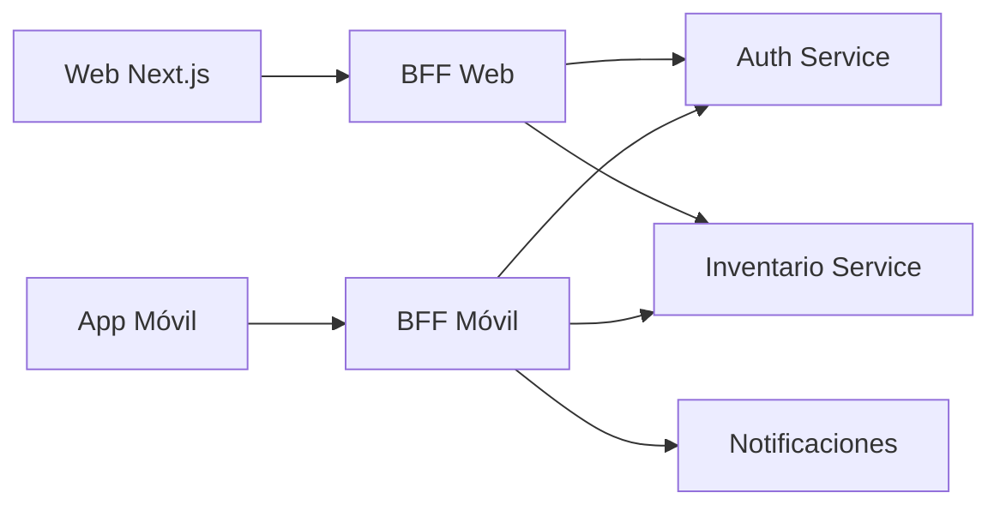
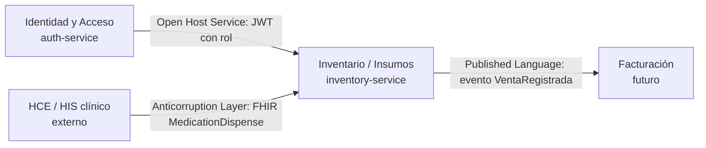
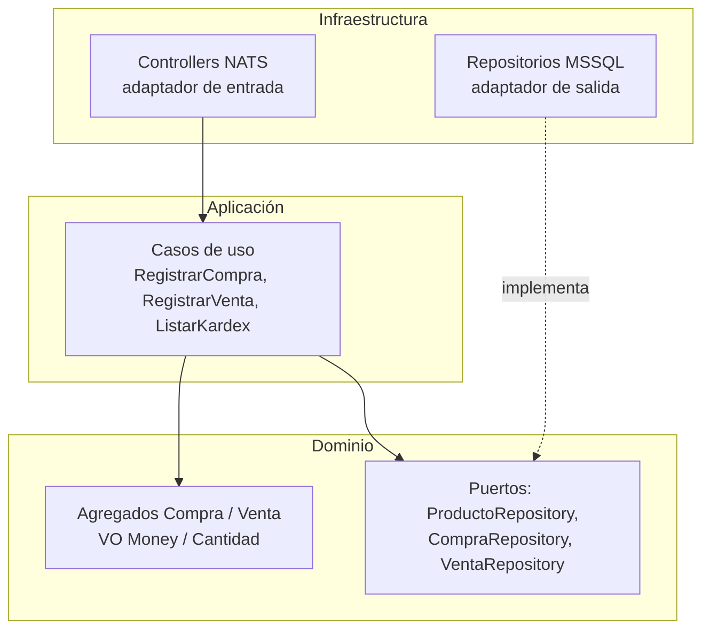
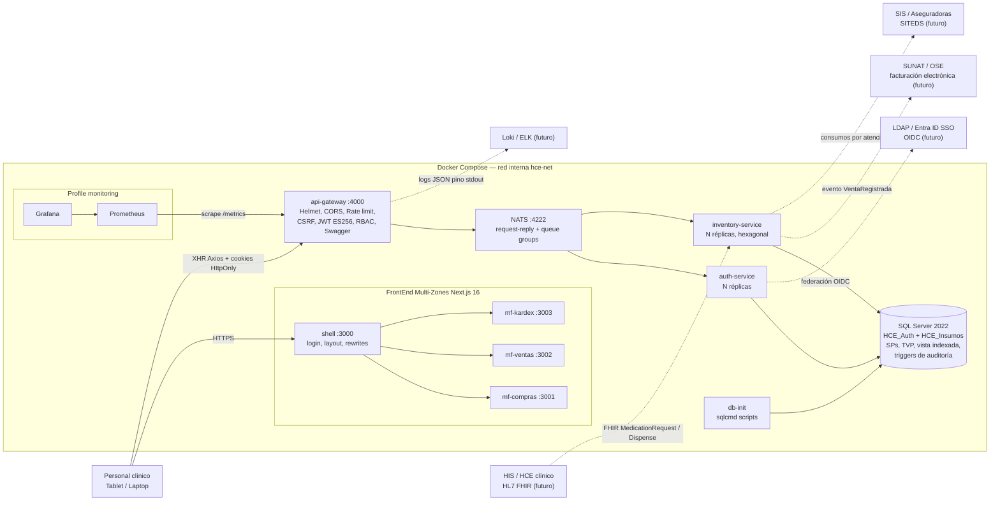

# Evaluación Teórica — Especialista Desarrollo HCE

> Respuestas aplicadas al caso real implementado en este repositorio: **HCE Insumos** (control de
> medicamentos/insumos en atenciones médicas). Cada concepto se aterriza en la solución entregada.

## Índice

1. [API REST](#1-api-rest)
2. [Arquitectura Monolítica vs Microservicios](#2-arquitectura-monolítica-vs-microservicios)
3. [Patrón BFF (Backend for Frontend)](#3-patrón-bff-backend-for-frontend)
4. [DDD (Domain-Driven Design)](#4-ddd-domain-driven-design)
5. [Arquitectura Hexagonal / Clean Architecture](#5-arquitectura-hexagonal--clean-architecture)
6. [Patrones de diseño: Facade y Decorator](#6-patrones-de-diseño-facade-y-decorator)
7. [Principios SOLID](#7-principios-solid)
8. [Diagrama de arquitectura (Docker, monitoreo e integraciones)](#8-diagrama-de-arquitectura-docker-monitoreo-e-integraciones)

---

## 1. API REST

### 1.1 Definición

**REST** (*REpresentational State Transfer*) es un **estilo arquitectónico** definido por Roy Fielding (2000)
para sistemas hipermedia distribuidos. Una API REST expone **recursos** (sustantivos: `productos`, `compras`,
`ventas`) identificados por URIs, que se manipulan mediante **representaciones** (JSON) usando la semántica
uniforme del protocolo HTTP. No es un protocolo ni un estándar: es un conjunto de restricciones.

### 1.2 Restricciones de Fielding

| Restricción | Significado | Cómo se aplica en HCE Insumos |
|---|---|---|
| **Cliente–Servidor** | Separación de responsabilidades UI ↔ datos | Next.js (front) y NestJS (back) se despliegan y evolucionan por separado |
| **Stateless** | Cada request contiene todo lo necesario; el servidor no guarda sesión | JWT autocontenido en cookie HttpOnly; el gateway valida localmente la firma ES256 sin estado → escala horizontal |
| **Cacheable** | Las respuestas declaran si son cacheables | `Cache-Control: no-store` en datos clínicos/sensibles; TanStack Query cachea en el cliente |
| **Interfaz uniforme** | Identificación de recursos, manipulación vía representaciones, mensajes autodescriptivos, HATEOAS | URIs por recurso, verbos HTTP, `Content-Type`, errores RFC 7807 |
| **Sistema en capas** | El cliente no sabe si habla con el servidor final o un intermediario | El front solo conoce al **API Gateway**; detrás hay microservicios NATS invisibles |
| **Código bajo demanda** (opcional) | El servidor puede enviar código ejecutable | No aplica |

### 1.3 Recursos, URIs y verbos

- URIs con **sustantivos en plural**, jerarquía para relaciones: `/kardex/{productoId}/movimientos`.
- Versionado en la ruta: `/api/v1/...`.
- Filtros, orden y paginación por query string: `/compras?desde=2026-01-01&page=2&pageSize=20`.

| Verbo | Uso | Seguro | Idempotente | Ejemplo |
|---|---|:---:|:---:|---|
| `GET` | Leer | ✅ | ✅ | `GET /productos/5` |
| `POST` | Crear / ejecutar un proceso | ❌ | ❌ (✅ con `Idempotency-Key`) | `POST /ventas` |
| `PUT` | Reemplazar completo | ❌ | ✅ | `PUT /productos/5` |
| `PATCH` | Modificación parcial | ❌ | ❌ (depende) | — |
| `DELETE` | Eliminar | ❌ | ✅ | `DELETE /productos/5` |
| `HEAD`/`OPTIONS` | Metadatos / preflight CORS | ✅ | ✅ | preflight del navegador |

### 1.4 Idempotencia

Una operación es **idempotente** si ejecutarla N veces deja el sistema en el mismo estado que ejecutarla una.
`POST` no lo es por naturaleza: si la red se corta después de que el servidor registró una venta, el reintento
del cliente registraría una **segunda venta** y descontaría stock dos veces — inaceptable en farmacia clínica.

**Solución implementada:** header `Idempotency-Key` (UUID v4) obligatorio en `POST /compras` y `POST /ventas`.
El SP guarda la clave con índice único filtrado; un reintento con la misma clave devuelve el documento
ya creado (mismo `id`) sin duplicar movimientos.

### 1.5 Códigos de estado HTTP

| Familia | Códigos usados | Semántica |
|---|---|---|
| 2xx | `200 OK`, `201 Created` (+ `Location`), `204 No Content` | Éxito |
| 4xx | `400` validación, `401` no autenticado, `403` sin permiso / CSRF, `404`, `409` conflicto/concurrencia, `422` regla de negocio (stock), `423` cuenta bloqueada, `429` rate limit | Error del cliente |
| 5xx | `500`, `502/503` microservicio no disponible, `504` timeout | Error del servidor |

Los errores siguen **RFC 7807 Problem Details** (`application/problem+json`) con un `code` estable
(`STOCK_INSUFICIENTE`, `CONCURRENCY_CONFLICT`…) para que el front reaccione sin parsear textos, y un
`requestId` para correlacionar con logs. Nunca se exponen stack traces ni mensajes SQL.

### 1.6 Versionado

| Estrategia | Ejemplo | Comentario |
|---|---|---|
| **URI** (elegida) | `/api/v1/productos` | Explícita, cacheable, fácil de enrutar en el gateway |
| Header | `Accept: application/vnd.hce.v2+json` | Más "puro", menos visible |
| Query | `?version=2` | Desaconsejado |

Regla: cambios **aditivos** no requieren versión nueva; cambios **rompientes** sí (`v2` convive con `v1`
durante un periodo de deprecación anunciado con header `Deprecation`/`Sunset`).

### 1.7 HATEOAS y Modelo de Madurez de Richardson

**HATEOAS** (*Hypermedia As The Engine Of Application State*): la respuesta incluye enlaces a las acciones
posibles (`_links: { self, movimientos }`), de modo que el cliente navega la API sin URIs codificadas.

| Nivel | Descripción | Ejemplo |
|---|---|---|
| 0 — Pantano de POX | Un endpoint, un verbo (RPC sobre HTTP) | `POST /api` con `{action:"listarVentas"}` |
| 1 — Recursos | URIs por recurso | `/ventas`, `/productos` |
| 2 — Verbos HTTP | Semántica de verbos y códigos | `GET /ventas`, `POST /ventas → 201` |
| 3 — Hipermedia | HATEOAS | `_links` en las respuestas |

La solución se ubica en **Nivel 2** (estándar de la industria). El nivel 3 aporta poco cuando el único
consumidor es un front propio con contrato tipado (OpenAPI); se dejaría para APIs públicas a terceros.

### 1.8 Seguridad — OWASP API Security Top 10 (2023)

| Riesgo | Mitigación en HCE Insumos |
|---|---|
| **API1** Broken Object Level Authorization | Autorización en el gateway por rol; el `userId` sale del JWT verificado, jamás del body |
| **API2** Broken Authentication | JWT ES256 de **30 min** en cookie HttpOnly/SameSite=Strict, refresh rotativo con detección de reuso, bloqueo de cuenta tras 5 intentos, rate limit 5/min en login, scrypt asíncrono |
| **API3** Broken Object Property Level Authorization | DTOs con `whitelist` + `forbidNonWhitelisted` (anti *mass assignment*); respuestas mapeadas a DTOs (sin campos internos) |
| **API4** Unrestricted Resource Consumption | Rate limiting global, `pageSize ≤ 100`, máx. 100 ítems por documento, body ≤ 100 KB, timeouts a microservicios |
| **API5** Broken Function Level Authorization | `@Roles()` + `RolesGuard` por endpoint (ADMIN / ALMACENERO / FARMACEUTICO) |
| **API6** Unrestricted Access to Sensitive Business Flows | Idempotency-Key, stock revalidado bajo lock, precio decidido por el servidor |
| **API7** SSRF | La API no consume URLs provistas por el usuario |
| **API8** Security Misconfiguration | Helmet, `X-Content-Type-Options: nosniff`, CORS restringido al origen del front, Swagger deshabilitado en producción, contenedores non-root |
| **API9** Improper Inventory Management | Versionado `/v1`, OpenAPI generado del código, colección Postman versionada |
| **API10** Unsafe Consumption of APIs | Validación de respuestas entre servicios mediante contratos tipados (`libs/contracts`), timeouts y mapeo de errores en la Facade |

---

## 2. Arquitectura Monolítica vs Microservicios

### 2.1 Definiciones

- **Monolito**: una sola unidad desplegable que contiene toda la funcionalidad (UI/API, lógica, acceso a datos)
  y normalmente una sola base de datos.
- **Microservicios**: conjunto de servicios pequeños, **autónomos y desplegables de forma independiente**,
  organizados alrededor de capacidades de negocio (*bounded contexts*), cada uno **dueño de sus datos**,
  que se comunican por red (HTTP, gRPC, mensajería).

### 2.2 Comparativa

| Dimensión | Monolito | Microservicios |
|---|---|---|
| Despliegue | Único artefacto; un cambio redepliega todo | Independiente por servicio |
| Escalado | Vertical o réplica completa | Granular: se escala solo el servicio con carga (p. ej. `inventory-service`) |
| Consistencia de datos | Transacciones ACID locales triviales | Consistencia eventual, sagas, outbox |
| Complejidad operativa | Baja | Alta: red, observabilidad distribuida, orquestación |
| Latencia | Llamadas en memoria | Llamadas de red (serialización, timeouts) |
| Aislamiento de fallos | Un bug puede tumbar todo | Fallo acotado (con timeouts / circuit breakers) |
| Heterogeneidad tecnológica | Una pila | Políglota por servicio |
| Equipos | Coordinación sobre un mismo código | Equipos autónomos por dominio (Ley de Conway) |
| Testing | E2E sencillo | Contratos + integración más costosos |
| Time-to-market inicial | Rápido | Más lento (infraestructura previa) |

### 2.3 Cuándo elegir cada uno

**Monolito (o monolito modular)** cuando: el dominio aún no está claro, el equipo es pequeño, el producto
es nuevo (MVP) o no hay madurez DevOps (CI/CD, observabilidad, contenedores).

**Microservicios** cuando: hay dominios bien delimitados con ritmos de cambio y cargas distintas, varios
equipos, necesidad de escalar partes específicas, requisitos de disponibilidad diferentes por módulo
(p. ej. la identidad debe estar siempre disponible; los reportes no).

### 2.4 Monolito modular

Punto intermedio recomendado como primer paso: un único desplegable con **módulos fuertemente
encapsulados** (cada uno con su API interna y su esquema), lo que permite extraerlos luego como
microservicios con bajo costo. La organización hexagonal del `inventory-service` sigue esta filosofía
internamente.

### 2.5 Costos reales de un sistema distribuido

Las **falacias de la computación distribuida** (la red es confiable, la latencia es cero…) obligan a:

- **Timeouts y reintentos** con backoff, solo sobre operaciones idempotentes.
- **Idempotencia** en los consumidores.
- **Observabilidad**: logs estructurados con `requestId` propagado, métricas, health checks.
- **Sin transacciones distribuidas**: cada servicio es dueño de su BD (`HCE_Auth`, `HCE_Insumos`); la
  consistencia entre contextos se resuelve con eventos/sagas, no con FKs cruzadas.
- **Versionado de contratos** entre servicios.

### 2.6 Decisión en esta solución

Microservicios (requisito del examen) con un tamaño **pragmático**: 3 servicios backend por bounded context
(**api-gateway**, **auth-service**, **inventory-service**), comunicados por **NATS** request-reply con
**queue groups** (balanceo automático entre réplicas → `docker compose up --scale inventory-service=3`).
Las operaciones de Compra/Venta/Kardex permanecen en el mismo servicio porque comparten una invariante
transaccional fuerte (stock); separarlas forzaría sagas innecesarias.

---

## 3. Patrón BFF (Backend for Frontend)

### 3.1 Qué es

Un **BFF** es una capa backend dedicada a **una experiencia de cliente específica** (web, móvil, kiosko).
Agrega, adapta y simplifica las llamadas a los servicios internos según lo que esa UI necesita, en lugar
de un API genérico "talla única".



### 3.2 Por qué

- **Menos round-trips**: una pantalla "Registrar venta" necesita productos + stock + precio → el BFF
  compone una sola respuesta.
- **Payloads a medida** (móvil con menos datos).
- **Seguridad**: el BFF es el único que maneja tokens; el navegador solo ve cookies HttpOnly (patrón
  "token handler"), mitigando robo de tokens por XSS.
- **Autonomía**: el equipo del front evoluciona su BFF sin afectar a otros clientes.

### 3.3 Riesgos

Duplicación de lógica entre BFFs (mitigar manteniendo la lógica de negocio en los servicios de dominio),
y un BFF que crece hasta convertirse en un monolito.

### 3.4 Relación con esta solución

- El **API Gateway NestJS** cumple el rol de BFF web: centraliza enrutamiento, autenticación, CSRF, rate
  limit, y **compone** datos (p. ej. `ProductoDto` incluye `stock` calculado desde la vista indexada, que
  es lo que la vista de ventas necesita).
- El **token handler** ya está implementado: el gateway emite/rota JWT en cookies HttpOnly; el JS del
  front nunca accede al token.
- **Evolución**: si se agrega una app móvil o un kiosko de farmacia, se crearía un BFF adicional (o se
  usarían los *Route Handlers* de Next.js del `shell` como BFF web), dejando el gateway como puerta
  de entrada genérica.

---

## 4. DDD (Domain-Driven Design)

DDD (Eric Evans, 2003) propone que el **modelo de software refleje el dominio de negocio**, construido en
colaboración con expertos (químicos farmacéuticos, logística, facturación).

### 4.1 Diseño estratégico

**Lenguaje ubicuo**: los mismos términos en conversaciones, código y BD. En el código del dominio se usa
`Compra`, `Venta`, `Kardex`, `Movimiento de Entrada/Salida`, `Lote`, `Precio de Venta`, `IGV` — no
`Order`, `Transaction` genéricos.

**Bounded contexts** (contextos delimitados) del dominio HCE Insumos:

| Contexto | Responsabilidad | Implementación |
|---|---|---|
| **Identidad y Acceso** | Usuarios, credenciales, sesiones, roles | `auth-service` + BD `HCE_Auth` |
| **Inventario / Insumos** | Productos, lotes, compras (entradas), ventas/dispensación (salidas), kardex, stock | `inventory-service` + BD `HCE_Insumos` |
| **Facturación** (futuro) | Comprobantes electrónicos SUNAT, notas de crédito | Servicio futuro, consume eventos `VentaRegistrada` |
| **Atención clínica / HCE** (externo) | Episodios de atención, prescripciones | Sistema HIS/HCE existente; integración vía HL7 FHIR |

**Context map**:



- **Identidad → Inventario**: *Open Host Service* / lenguaje publicado (claims JWT: `sub`, `rol`).
- **Inventario → Facturación**: *Customer/Supplier* mediante eventos de dominio.
- **HCE → Inventario**: *Anticorruption Layer* (adaptador que traduce recursos FHIR al modelo propio y
  protege al dominio de modelos externos).

### 4.2 Diseño táctico

| Bloque | Definición | Ejemplo en el código |
|---|---|---|
| **Entidad** | Identidad que persiste en el tiempo | `Producto` (id, nombre, lote, costo, precioVenta) |
| **Value Object** | Inmutable, igualdad por valor, se autovalida | `Money` (aritmética en céntimos, redondeo), `Cantidad` (entero > 0) |
| **Agregado** | Cluster de objetos con una raíz que protege invariantes | `Compra` (raíz) + `LineaCompra`; `Venta` + `LineaVenta` — invariantes: ≥1 línea, productos únicos, totales = Σ líneas, cantidad ≤ stock |
| **Repositorio** | Abstracción de colección para agregados (puerto) | `CompraRepository`, `VentaRepository`, `ProductoRepository` (interfaces en `domain/`) |
| **Servicio de dominio** | Lógica que no pertenece a una entidad | Política de precio: `precioVenta = round(costo × 1.35, 2)` |
| **Evento de dominio** | Algo relevante que ocurrió | `CompraRegistrada`, `VentaRegistrada` (base para facturación/alertas de stock mínimo) |
| **Servicio de aplicación / caso de uso** | Orquesta: carga agregados, invoca dominio, persiste | `RegistrarVentaUseCase`, `ListarKardexUseCase` |

```ts
// Extracto simplificado de domain/shared/money.ts — Value Object: sin errores de punto flotante
export class Money {
  private constructor(private readonly cents: number) {}
  static of(amount: number): Money {
    if (!Number.isFinite(amount) || amount < 0) throw new DomainError('Monto inválido');
    return new Money(Math.round(amount * 100));
  }
  add(o: Money) { return new Money(this.cents + o.cents); }
  times(q: number) { return new Money(this.cents * q); }
  percent(rate: number) { return new Money(Math.round(this.cents * rate)); }
  get value() { return this.cents / 100; }
}

// Extracto simplificado de domain/venta/venta.ts — Agregado: protege la invariante de stock
export class Venta {
  static crear(lineas: { producto: ProductoSnapshot; cantidad: number }[], igvRate: number): Venta {
    if (lineas.length === 0) throw new DomainError('La venta debe tener al menos un producto');
    for (const l of lineas) {
      if (l.cantidad > l.producto.stock)
        throw new StockInsuficienteError(l.producto.id, l.producto.stock, l.cantidad);
    }
    return new Venta(lineas.map((l) => LineaVenta.crear(l.producto, l.cantidad, igvRate)));
  }
}
```

---

## 5. Arquitectura Hexagonal / Clean Architecture

**Hexagonal (Ports & Adapters, Alistair Cockburn)**: el **dominio** y los **casos de uso** están en el centro
y no dependen de nada externo. Se comunican con el mundo a través de **puertos** (interfaces), implementados
por **adaptadores**:

- **Adaptadores de entrada (driving)**: controladores NATS (`@MessagePattern`), CLI, tests.
- **Adaptadores de salida (driven)**: repositorios SQL Server (`mssql` + SPs), reloj, logger, publicador
  de eventos.

**Regla de dependencias** (Clean Architecture, R. C. Martin): las dependencias apuntan siempre hacia
adentro. `domain` no importa NestJS ni `mssql`.



```ts
// Extracto simplificado de domain/venta/venta.repository.port.ts — Puerto
export const VENTA_REPOSITORY = Symbol('VENTA_REPOSITORY');
export interface VentaRepository {
  registrar(venta: Venta, ctx: { usuarioId: string; idempotencyKey: string }): Promise<number>;
  obtener(id: number): Promise<VentaDetalle | null>;
}

// infrastructure/persistence/mssql/mssql-venta.repository.ts — Adaptador
@Injectable()
export class MssqlVentaRepository implements VentaRepository {
  constructor(private readonly db: MssqlExecutor) {}
  async registrar(venta: Venta, ctx: Ctx): Promise<number> {
    const tvp = toLineasTvp(venta.lineas);                 // TVP: 1 solo round-trip
    const r = await this.db.execProc('dbo.usp_Venta_Registrar', { Lineas: tvp, ...ctx });
    return r.output.Id_VentaCab;
  }
}
```

Beneficio: cambiar SQL Server por otro motor, o NATS por gRPC/Kafka, **no toca el dominio**; los casos de uso se
prueban con repositorios en memoria en milisegundos. (Justificación específica para salud en
[ARQUITECTURA.md](./ARQUITECTURA.md#justificación-de-arquitectura-hexagonal-en-sistemas-de-salud)).

---

## 6. Patrones de diseño: Facade y Decorator

### 6.1 Facade (estructural)

**Intención**: ofrecer una interfaz simple y unificada sobre un subsistema complejo.

En el gateway, los controladores HTTP no conocen NATS, patrones de mensaje, timeouts ni el formato de
error RPC. Todo eso lo oculta `InventarioFacade` (y `AuthFacade`):

```ts
// apps/api-gateway/src/inventario/inventario.facade.ts
@Injectable()
export class InventarioFacade {
  constructor(@Inject(INVENTORY_CLIENT) private readonly client: ClientProxy, private readonly cfg: GatewayConfig) {}

  registrarVenta(dto: RegistrarVentaDto, ctx: RequestContext): Promise<VentaDetalleDto> {
    return this.send(PATTERNS.VENTA_REGISTRAR, { ...dto, ctx });
  }
  listarKardex(q: KardexQueryDto, ctx: RequestContext): Promise<Paginated<KardexItemDto>> {
    return this.send(PATTERNS.KARDEX_LISTAR, { ...q, ctx });
  }

  private send<T>(pattern: string, payload: unknown): Promise<T> {
    return firstValueFrom(
      this.client.send<T>(pattern, payload).pipe(
        timeout(this.cfg.rpcTimeoutMs),        // nunca colgar un request HTTP
        catchError(mapRpcErrorToHttp),         // RpcException → ProblemDetails HTTP
      ),
    );
  }
}

// Controller: delgado, solo HTTP
@Post() @Roles('ADMIN', 'FARMACEUTICO') @Idempotent()
registrar(@Body() dto: RegistrarVentaDto, @CurrentUser() u: AuthUser, @Ctx() ctx: RequestContext) {
  return this.inventario.registrarVenta(dto, ctx);
}
```

### 6.2 Decorator (estructural)

**Intención**: agregar responsabilidades a un objeto dinámicamente, sin modificar su clase (OCP).

**a) GoF clásico** — envolver casos de uso con logging/métricas sin tocarlos:

```ts
// apps/inventory-service/src/application/decorators/observed-use-case.decorator.ts
export interface UseCase<I, O> { execute(input: I): Promise<O>; }

export class ObservedUseCase<I, O> implements UseCase<I, O> {
  constructor(private readonly inner: UseCase<I, O>, private readonly name: string, private readonly logger: Logger) {}
  async execute(input: I): Promise<O> {
    const start = performance.now();
    try {
      const out = await this.inner.execute(input);
      this.logger.log({ useCase: this.name, ms: performance.now() - start }, 'use-case ok');
      return out;
    } catch (e) {
      this.logger.warn({ useCase: this.name, ms: performance.now() - start, err: e }, 'use-case failed');
      throw e;
    }
  }
}
// Registro en el módulo: { provide: REGISTRAR_VENTA, useFactory: (r) => new ObservedUseCase(new RegistrarVentaUseCase(r), 'RegistrarVenta', logger) }
```

**b) Decoradores de TypeScript/NestJS** (metadatos + composición con `applyDecorators`):

```ts
export const Roles = (...roles: Rol[]) => SetMetadata(ROLES_KEY, roles);
export const Public = () => SetMetadata(IS_PUBLIC_KEY, true);
export const CurrentUser = createParamDecorator((_, ctx: ExecutionContext) => ctx.switchToHttp().getRequest().user);

// Decorador compuesto: un endpoint de documento idempotente y documentado en una sola línea
export const Idempotent = () =>
  applyDecorators(
    UseInterceptors(IdempotencyKeyInterceptor),
    ApiHeader({ name: 'Idempotency-Key', required: true, description: 'UUID v4' }),
  );
```

---

## 7. Principios SOLID

| Principio | Enunciado | Aplicación concreta |
|---|---|---|
| **S** — Responsabilidad única | Una clase, una razón para cambiar | Controller (HTTP) ≠ Facade (transporte) ≠ Caso de uso (orquestación) ≠ Agregado (reglas) ≠ Repositorio (persistencia) |
| **O** — Abierto/Cerrado | Extender sin modificar | `ObservedUseCase` agrega observabilidad sin editar `RegistrarVentaUseCase`; nuevos guards/interceptores sin tocar controladores |
| **L** — Sustitución de Liskov | Las implementaciones son intercambiables | `MssqlVentaRepository` y los dobles de prueba (`jest.Mocked<VentaRepository>`) cumplen el mismo contrato; los tests de casos de uso usan los dobles |
| **I** — Segregación de interfaces | Interfaces pequeñas y específicas | Puertos por agregado (`ProductoRepository`, `CompraRepository`, `VentaRepository`) y `KardexReadModel` solo lectura (CQRS ligero); `UseCase<I,O>` expone un único método |
| **D** — Inversión de dependencias | Depender de abstracciones | Los casos de uso son clases TypeScript puras que reciben **puertos** (interfaces) por constructor; el *composition root* (`inventory.module.ts`) los resuelve con tokens (`VENTA_REPOSITORY`) — nunca importan `mssql` |

```ts
// DIP + ISP: el caso de uso solo conoce los puertos que necesita (sin decoradores de framework)
export class RegistrarVentaUseCase implements UseCase<RegistrarVentaRequest, VentaDetalleDto> {
  constructor(
    private readonly productos: ProductoRepository, // puerto
    private readonly ventas: VentaRepository,       // puerto
    private readonly politica: PoliticaPrecios,     // servicio de dominio
  ) {}
  async execute(input: RegistrarVentaRequest, ctx: RequestContext) {
    const productos = await this.productos.obtenerPorIds(input.items.map((i) => i.productoId));
    const venta = Venta.registrar(input.items, new Map(productos.map((p) => [p.id, p])), this.politica); // reglas en el dominio
    const r = await this.ventas.registrar(venta, { idempotencyKey, requestHash }, ctx);                    // revalidación atómica en BD
    return this.ventas.obtener(r.id);
  }
}
```

---

## 8. Diagrama de arquitectura (Docker, monitoreo e integraciones)

Leyenda: líneas continuas = **implementado**; líneas punteadas y nodos con "(futuro)" = **integraciones
propuestas**.



| Componente | Estado | Notas |
|---|---|---|
| Next.js Multi-Zones (4 apps) | Implementado | Microfronts desplegables por separado, compuestos por rewrites del `shell` |
| API Gateway NestJS | Implementado | Única puerta HTTP pública |
| auth-service / inventory-service | Implementado | NATS, escalables con `--scale` |
| SQL Server 2022 | Implementado | Una BD por servicio, logins de mínimo privilegio |
| Prometheus + Grafana | Implementado (perfil `monitoring`) | `docker compose --profile monitoring up` |
| Logs centralizados (Loki/ELK) | Futuro | Logs ya son JSON estructurados con `requestId` |
| SUNAT, HIS/FHIR, SIS, SSO | Futuro | Se agregarían como adaptadores (hexagonal) sin tocar el dominio |
