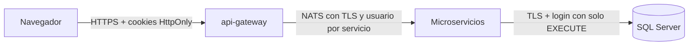

# Seguridad: amenazas y controles

Referencia: OWASP Top 10 2021, OWASP API Security Top 10 2023 y OWASP ASVS (V2 a V5). Cada tabla indica la
amenaza, el control aplicado y dónde se comprueba.

## Capas

Solo el front (3000) y el gateway (4000) se publican, y únicamente en `127.0.0.1`. NATS, los microservicios y
SQL Server quedan en redes internas de Docker.

## Identidad y sesión

| Amenaza | Control | Dónde se comprueba |
|---|---|---|
| Robo del token con XSS | El JWT va solo en cookies `HttpOnly`, `SameSite=Strict` y `Secure`. JavaScript no puede leerlo y no se usa `localStorage` | e2e: cookies HttpOnly y respuesta sin tokens |
| Token falsificado | JWT ES256: la clave privada solo está en auth-service; el gateway verifica con la pública. Se fijan `alg`, `iss` y `aud` | e2e: `alg:none` y firma ajena devuelven 401 |
| Refresh token robado | Se guarda solo su hash SHA-256, cambia en cada uso y, si se reutiliza uno viejo, se revoca toda la sesión | `refresh-session.use-case.spec.ts` |
| Sesión sin fin | Access token de 30 min y sesión de 12 h como máximo, aunque se renueve | `usp_Sesion_Rotar` |
| Token válido después del logout | El JWT lleva el id de sesión (`sid`). El logout publica `session-revoked` por NATS y todos los gateways lo rechazan de inmediato | e2e "sesión revocada" |
| Fuerza bruta | Límite de 10 intentos de login por minuto por IP y como máximo 5 intentos por cuenta cada 15 min. El intento se reserva en SQL antes de verificar la contraseña, así que peticiones simultáneas no lo saltan | `usp_Login_ReservarIntento` |
| Descubrir qué correos existen | La respuesta y el tiempo son iguales para usuario inexistente, inactivo, bloqueado o contraseña errónea | `login.use-case.spec.ts` |
| Contraseñas filtradas desde la base | argon2id (19 MiB, t = 2, p = 1) con sal aleatoria y comparación en tiempo constante | `versioned-password-hasher.spec.ts` |
| CSRF | Token CSRF firmado y ligado a la sesión en el header `X-CSRF-Token`, cookies `SameSite=Strict`, CORS solo para el front y `Content-Type` JSON obligatorio | e2e: token de otra sesión devuelve 403 |

## Autorización

| Amenaza | Control | Dónde se comprueba |
|---|---|---|
| Roles demasiado amplios o rígidos | Permisos por acción (`compras.registrar`, `productos.precio_manual`…). El rol da los permisos base y el administrador puede conceder o quitar uno a un usuario, con motivo y fecha de vencimiento | `04b_auth_permisos.sql` |
| Saltarse la autorización | El permiso se revisa en el gateway (`PermissionsGuard`) y otra vez en el microservicio (`AuthorizedUseCase`). En la UI solo se ocultan opciones | `permissions.guard.spec.ts`, `authorized-use-case.decorator.spec.ts` |
| Permisos viejos en un token vigente | Al cambiar permisos se publica `permissions-changed`; el token anterior recibe 401 y el front lo renueva sin cerrar sesión | e2e "permisos cambiados" |
| Quedarse sin administrador | Un administrador no puede quitarse a sí mismo `seguridad.administrar` | `usp_Admin_Excepcion_Guardar` |
| Cambios de permisos sin rastro | `auth.PermisoBitacora` guarda quién, qué y cuándo; un trigger impide modificarla | `04b_auth_permisos.sql` |

## Integridad del negocio

| Amenaza | Control | Dónde se comprueba |
|---|---|---|
| Vender más de lo que hay | El SP bloquea los productos (`UPDLOCK, HOLDLOCK`) siempre en el mismo orden y revalida el stock | 15 ventas simultáneas con stock 7: 7 aceptadas |
| Precio alterado desde el navegador | El precio de venta lo pone el servidor. El precio manual exige `productos.precio_manual` y no puede ser menor al costo | `actualizar-producto.use-case.spec.ts` |
| Documento duplicado por reintento | Header `Idempotency-Key`: un reintento devuelve el documento ya creado. La clave queda ligada al usuario | `registrar-venta.use-case.spec.ts` |
| Alterar el kardex o un documento | Triggers `INSTEAD OF UPDATE, DELETE` en documentos, movimientos y auditoría. Nombre y lote no cambian si el producto ya tiene movimientos | `02_insumos_audit.sql`, `usp_Producto_Actualizar` |
| Errores de redondeo | Montos en céntimos enteros en el código y `CHECK (Total = SubTotal + Igv)` en la base | `money.spec.ts` |

## Entrada y errores

| Amenaza | Control |
|---|---|
| Inyección SQL | Solo procedimientos almacenados con parámetros tipados. El login de la aplicación solo puede ejecutar SP, no leer tablas |
| Payloads maliciosos | `SanitizeInputMiddleware` rechaza claves `__proto__`, `constructor` y `prototype`, quita caracteres de control e invisibles y limita profundidad y longitud |
| Campos no esperados | `ValidationPipe` con `whitelist` y `forbidNonWhitelisted` |
| XSS | React escapa la salida; CSP con *nonce* y sin `unsafe-inline` para scripts |
| Redirección abierta | `safeNextPath` solo acepta rutas internas (`/.//evil.com` se rechaza) |
| Detalles internos en errores | Formato RFC 7807; los errores 5xx son genéricos e incluyen un `requestId` para buscar en los logs |
| Saturación | Body de 100 kb, 100 líneas por documento, 100 filas por página, timeouts de 15 s por petición, 8 s por mensaje NATS y 6 s por consulta, y límite de peticiones |
| Fallo inesperado del proceso | `unhandledRejection` y `uncaughtException` se registran y el proceso se cierra de forma ordenada |

## Infraestructura

- **TLS interno:** `setup.sh` crea una CA propia. NATS (TLS 1.3) y SQL Server (`forceencryption`) usan certificados
  firmados por ella y los clientes los verifican.
- **NATS:** cada servicio tiene su usuario y solo puede publicar o escuchar sus propios temas.
- **Redes:** `backend` y `data` son internas, sin salida a internet. SQL Server no se publica; el archivo
  `docker-compose.db-access.yml` lo expone en `127.0.0.1` solo para administrarlo en local.
- **Contenedores:** usuario no root, sistema de archivos de solo lectura, `cap_drop: ALL` y `no-new-privileges`.
- **Dependencias:** imágenes fijadas por *digest*, versiones exactas, lockfiles, `pnpm audit`, Dependabot, gitleaks
  y Trivy en CI.
- **Secretos:** los genera `setup.sh` y no se versionan. Por defecto Swagger está apagado, las cookies son `Secure`
  y no se cargan datos demo.

## Registro y alertas

- Cada login fallido, 401, 403, error CSRF o límite de peticiones se registra con `requestId`, IP, usuario y ruta.
  Los logs ocultan cookies, tokens y contraseñas.
- La métrica `hce_security_events_total` alimenta alertas de Prometheus (`infra/monitoring/alerts.yml`) para picos
  de logins fallidos, CSRF o 403, errores 5xx, latencia alta y servicios caídos.

## Alcance de algunos controles

- **Límite de peticiones por réplica.** Se guarda en memoria de cada gateway. El bloqueo de cuenta por intentos
  fallidos es global porque está en SQL Server.
- **Revocaciones en memoria.** Una réplica del gateway que arranca después de un cierre de sesión no lo conoce;
  ese token sigue sirviendo como máximo hasta que vence (30 min).
- **Usuario en la auditoría.** Cada SP de escritura fija el usuario en `SESSION_CONTEXT`, así los triggers saben
  quién hizo el cambio aunque la conexión venga del pool.
- **Usuario `sa`.** Solo lo usa `db-init` dentro de la red `data` y termina al acabar los scripts. Los servicios usan
  logins que solo pueden ejecutar SP.
